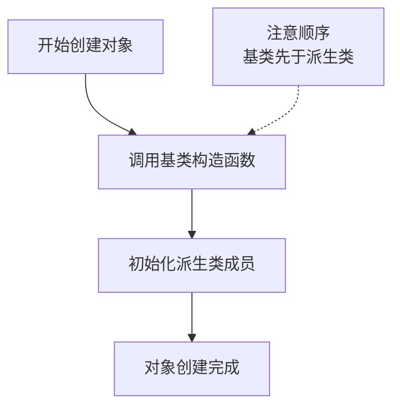

# 派生类的定义语法
在面向对象程序设计中，继承是实现代码复用和构建类层次结构的核心机制。派生类（Derived Class）是从基类（Base Class）继承而来的新类，它既保留了基类的特性，又扩展了新的功能。

### 为什么需要派生类？

想象一下，如果我们要设计一个学校管理系统，`Student`（学生）和 `Teacher`（教师）都有姓名、年龄等共同属性。如果不使用继承，我们需要分别定义两个完全独立的类，导致大量代码重复。通过定义一个基类 `Person`，让 `Student` 和 `Teacher` 继承自 `Person`，我们可以==集中管理共性==，并在派生类中只关注各自的特有行为（如学生的学号、教师的职称）。

### 怎么做：定义语法

C++ 中派生类的定义格式如下：

```cpp
class 派生类名 : [继承方式] 基类名 {
    // 派生类新增的成员
};
```

其中，`继承方式` 可以是 `public`、`protected` 或 `private`。若省略，对于 `class` 关键字定义的类，默认是 `private` 继承；对于 `struct` 则是 `public` 继承。

> [!IMPORTANT]
> 南邮课程重点：**派生类对基类默认的继承方式是 private**（针对 class）。这与选项 D 的描述相反，因此选择题 14 中 D 是错误的。

### 继承访问控制与成员可见性

基类成员在派生类中的访问权限取决于**基类成员的原始权限**和**继承方式**。这是考试中最容易混淆的部分，请参考下表：

| 基类成员 | public 继承 | protected 继承 | private 继承 |
| :--- | :--- | :--- | :--- |
| **private** | 不可直接访问 | 不可直接访问 | 不可直接访问 |
| **protected** | protected | protected | private |
| **public** | public | protected | private |

> [!WARNING]
> **核心陷阱**：无论何种继承方式，基类的 `private` 成员在派生类中都是**不可直接访问**的。它们虽然被继承了（占用内存），但派生类的成员函数不能直接使用它们，必须通过基类的 `public` 或 `protected` 接口访问。这也是选择题 3 板书强调的重点。

### 常见误区与辨析

1.  **同名函数处理**：派生类中可以定义与基类同名的函数。这会导致**隐藏**（Hiding）而非重载。如果意图是多态，需使用 `virtual` 关键字。选择题 14 中 A 选项正确，因为语法上允许定义同名函数。
2.  **多层继承**：一个派生类完全可以作为另一个类的基类，形成继承链。因此选择题 14 中 B 选项错误。
3.  **构造函数调用**：派生类对象创建时，必须先调用基类构造函数初始化基类部分。



### 算对了的例子

回顾选择题 14：
*   **A. 派生类中可以定义和基类同名的函数**：✅ 正确。这是合法的，尽管可能隐藏基类版本。
*   **B. 一个派生类不能再作为其他派生类的基类**：❌ 错误。支持多层继承。
*   **C. 基类中所有成员函数都能被派生类继承**：❌ 错误。虽然物理上继承，但 `private` 成员无法在派生类内部直接访问，且构造函数/析构函数不被继承。
*   **D. 派生类对基类默认的继承方式是 public 继承**：❌ 错误。`class` 默认是 `private` 继承。

因此，正确答案为 **A**。

> [!TIP]
> 记忆口诀：**私有不访问，公有看继承，保护变私有，默认是私有。**
