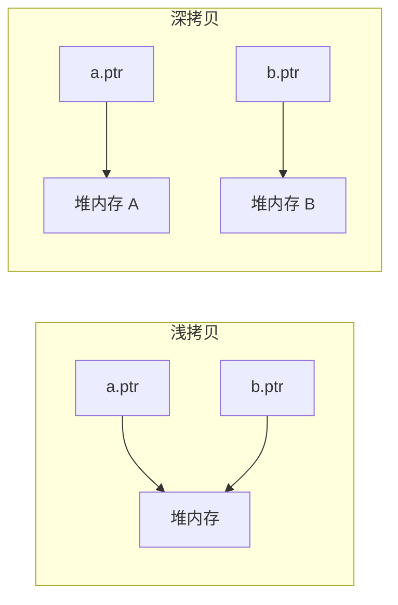
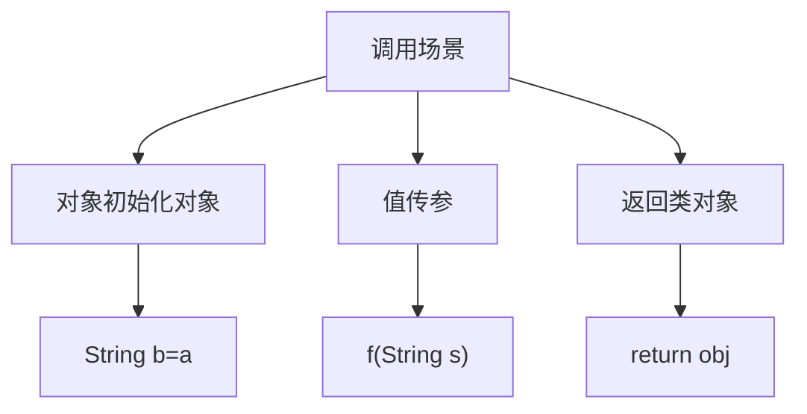

# 深拷贝与浅拷贝

## 它是什么

先想一个问题：如果一个类里有一块**动态分配的内存**（比如 `new char[20]` 存字符串），我们把对象 a 复制成对象 b，b 应该和 a **共用同一块内存**，还是**自己再申请一块、把内容抄过去**？

- 共用内存 ⇒ ==浅拷贝==（shallow copy），只复制指针本身的值。
- 自己申请 ⇒ ==深拷贝==（deep copy），复制指针指向的**数据内容**。



> [!IMPORTANT]
> 系统默认生成的拷贝构造函数是 ==浅拷贝==，只做"逐成员赋值"。成员含指针时必须==自定义拷贝构造函数做深拷贝==。

## 为什么需要深拷贝

如果只做浅拷贝，两个对象指向同一块堆内存，析构时会 `delete` 两次同一块空间——==重复释放（double free）==，程序崩溃；改 a 的内容也会"莫名其妙"改到 b。这就是必须写深拷贝拷贝构造函数的根本原因。

## 拷贝构造函数怎么写

==形式参数是本类对象的常引用==：`类名(const 类名 &other)`。用引用是为了避免"传值调用又触发拷贝构造"造成无限递归；加 `const` 是为了允许用常量/临时对象初始化。

```cpp
class String {
    char *p;
public:
    String(const String &s) {          // 深拷贝拷贝构造
        p = new char[strlen(s.p) + 1];
        strcpy(p, s.p);
    }
};
```

> [!WARNING]
> 不写 `&` 会无限递归栈溢出；忘写 `new` 又回到浅拷贝的老路。

## 拷贝构造函数被调用的三种情况



> [!TIP]
> 口诀：==初、参、返==——初始化、传参、返回，三处必调拷贝构造。

## 浅拷贝 vs 深拷贝

| 对比项 | 浅拷贝 | 深拷贝 |
| --- | --- | --- |
| 复制内容 | 指针值 | 指针指向的数据 |
| 堆内存 | 共享 | 各自独立 |
| 析构 | 易 double free | 安全 |
| 是否需手写 | 否（默认） | 是（含指针时） |

## 一个算对了的例子

```cpp
class A {
    int *p;
public:
    A(int v) { p = new int(v); }
    A(const A &q) { p = new int(*q.p); }   // 深拷贝
    ~A() { delete p; }
};
int main() {
    A a(8); A b(a);        // 触发拷贝构造
    cout << *b.p;          // 输出 8
}                          // 析构 a、b 各自 delete，安全
```

输出第一行 `8`，程序正常结束 `return 0`（最后输出 `0`）。

> [!CAUTION]
> 考试常考：让读程输出首行/末行，关键看==拷贝构造是深还是浅==、析构是否重复释放。
