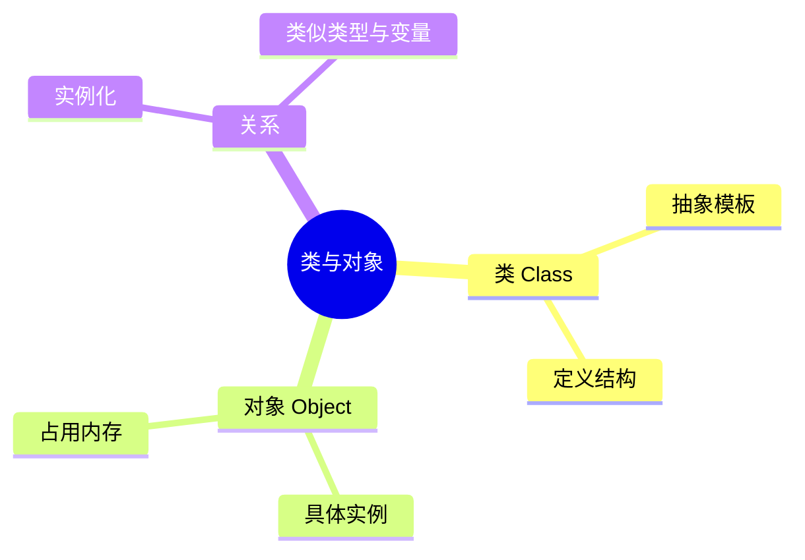

# 类与对象的基本概念

## 什么是类与对象

C++ 相对于 C 语言最根本的变化，在于**引进了类和对象的概念**。这是面向对象程序设计（OOP）的基石。

想象一下，如果要描述“学生”，在 C 语言中你可能需要分别定义姓名（字符数组）、学号（整数）、成绩（浮点数），且这些数据是分散的。而在 C++ 中，我们将这些属性（数据）和行为（函数）封装在一起，形成一个模板，这就是**类（Class）**。而根据这个模板创建出来的具体个体，就是**对象（Object）**。

> [!IMPORTANT]
> **核心关系**：类是对象的抽象（模板），对象是类的实例（实体）。二者关系类似于 **数据类型** 与 **变量** 的关系。

## 为什么需要它们

面向对象的三大特征是：**封装、继承、多态**。

1.  **封装**：将数据和操作绑定，隐藏内部实现细节，只暴露接口。这提高了代码的安全性和模块化程度。
2.  **继承**：允许新类基于现有类构建，复用代码。
3.  **多态**：同一操作作用于不同对象产生不同行为。

如果没有类与对象，程序将是一堆分散的函数和全局变量，难以维护大型软件系统。

## 常见误区与考点辨析

很多初学者容易混淆类与对象的数量关系及访问方式。

| 概念 | 正确理解 | 常见错误 |
| :--- | :--- | :--- |
| **数量关系** | 一个类可以创建**多个**对象 | ==误认为一个类只能有一个对象== |
| **归属关系** | 一个对象只能属于**一个**具体的类 | 误认为对象可属于多个类 |
| **实例化** | 对象是类的实例 | 误认为类是对象的实例 |

> [!WARNING]
> **高频陷阱**：考题常问“一个类只能有一个对象”是否正确。**答案是否定的**。类只是蓝图，你可以用一张蓝图盖无数栋房子（对象）。

## 指针成员访问操作

当涉及指向类数据成员的指针时，语法较为特殊。假设 `p` 是指向类 `A` 数据成员 `m` 的指针，`A1` 是类 `A` 的对象。

若要给 `m` 赋值为 5，必须使用 `.*` 运算符结合对象和成员指针。

*   `A1.p`：错误，`p` 不是 `A1` 的直接成员。
*   `A1->p`：错误，`->` 用于对象指针，且 `p` 非成员名。
*   `*A1.p`：错误，优先级问题，等价于 `*(A1.p)`。
*   ==`A1.*p = 5`==：**正确**。`.*` 是成员指针解引用运算符。

> [!TIP]
> **记忆技巧**：
> *   对象访问成员：`obj.member`
> *   指针访问成员：`ptr->member`
> *   对象+成员指针：`obj.*ptrMem`
> *   指针+成员指针：`ptr->*ptrMem`

通过理解类作为“类型”、对象作为“变量”的本质，以及掌握正确的访问语法，就能从容应对此类基础考题。
