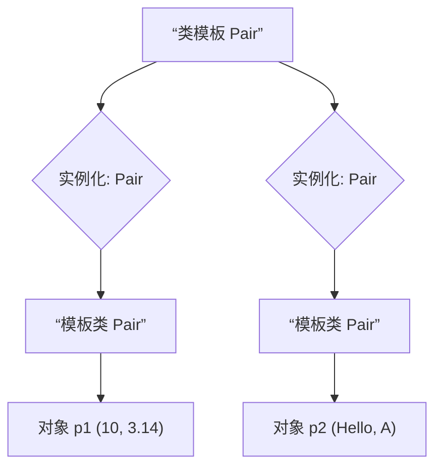

# 类模板的定义、使用及模板类的生成

---

## 为什么需要类模板

在编写程序时，我们经常会遇到这样的情况：需要一个栈（Stack）来存储整数，又需要一个栈来存储字符串。两个栈的逻辑完全相同（push、pop、top），唯一区别就是存储元素的类型不同。

如果不使用模板，你只能：
1.  为每种类型写一个类，导致代码大量重复。
2.  使用 `void*` 或继承来通用化，但这会丧失类型安全性，容易出错。

类模板（Class Template）正是为了解决这个问题而诞生的。它让你可以定义一个**与类型无关的类**，编译器负责为你生成具体类型的代码。

> [!IMPORTANT]
> 类模板本身不是类，它只是一个“蓝图”。只有当你指定了具体类型（实例化）后，编译器才会根据这个蓝图生成真正的类，即 ==模板类==。

## 类模板的定义

定义一个类模板的语法，是在普通类定义前加上 `template <class T>` 或 `template <typename T>`。这里的 `T` 是一个类型参数，代表一个待定的数据类型。

定义一个通用的 `Pair` 类，它包含两个值，可以是任意类型：

```cpp
template <class T, class U> 
class Pair {
private:
    T first;   // T 类型的成员
    U second;  // U 类型的成员
public:
    Pair(T f, U s) : first(f), second(s) {} // 构造函数

    T getFirst() const { return first; }   // 返回 T 类型
    U getSecond() const { return second; } // 返回 U 类型
};
```

> [!NOTE]
> 在类模板中使用成员函数时，可以像在普通类中一样直接使用类型参数 `T` 和 `U`。如果在**类外定义**成员函数，则需要带上模板声明和类作用域，如：
> ```cpp
> template <class T, class U>
> T Pair<T, U>::getFirst() const { return first; }
> ```

## 类模板的使用与模板类的生成

使用类模板的过程，就是**实例化**的过程。你必须在类名后用尖括号 `<>` 显式指定具体的类型参数，编译器此时才会用这些具体类型去替换蓝图中的参数 `T`、`U`，生成一个实际的、可用的类。

```cpp
int main() {
    // 实例化1：Pair<int, double>
    // 编译器生成了一个 T->int, U->double 的类，并创建了对象 p1
    Pair<int, double> p1(10, 3.14);
    int a = p1.getFirst();     // a = 10
    double b = p1.getSecond(); // b = 3.14

    // 实例化2：Pair<string, char>
    // 编译器生成了一个全新的类，T->string, U->char
    Pair<string, char> p2("Hello", 'A');
    string s = p2.getFirst();  // s = "Hello"

    return 0;
}
```

这个过程可以用下图清晰表达：



## 常见的坑

### 1. 分离编译问题
类模板的定义和实现通常**必须放在同一个头文件**中。因为模板的实例化是编译时行为，编译器在实例化时需要看到完整的定义。如果将成员函数实现放到 `.cpp` 文件，链接时会报未定义符号的错误。

> [!CAUTION]
> ==切记：不要将类模板的声明和定义分离到 `.h` 和 `.cpp` 文件中==，这是初学模板时最常犯的错误。

### 2. 忽视了类型参数的一致性
当你实例化时，必须保证所有使用到类型参数的地方类型是兼容的。

```cpp
Pair<int, double> p3(3.14, 5); // 合法，3.14 会隐式转换为 int 给 first。
int x = p3.getFirst();        // x = 3

// Pair<int> p4(1, 2);         // 错误！Pair 需要两个类型参数。
```

### 3. 默认类型参数
类模板的模板参数可以拥有默认值，这为它提供了极大的灵活性。标准库中的 `vector`、`stack` 等都有默认参数（如分配器 `allocator`）。

```cpp
template <class T, class U = int> // 默认 U 为 int
class Pair { /* ... */ };

Pair<double> p5(3.14, 100); // 等于 Pair<double, int>
```

## 算对一个例子

题目：定义一个类模板 `Array`，可以存储指定类型和指定大小的数组，并提供下标访问功能。然后对其分别以 `int` 和 `double` 类型进行实例化并访问元素。

```cpp
#include <iostream>
#include <stdexcept>
using namespace std;

// 类模板定义：类型参数 T，非类型参数 N
template <class T, int N>
class Array {
private:
    T data[N]; // 固定大小的内建数组
public:
    // 下标访问，带越界检查
    T& operator[](int index) {
        if (index < 0 || index >= N) {
            throw out_of_range("Array index out of range");
        }
        return data[index];
    }
    int size() const { return N; }
};

int main() {
    // 实例化 1：5个元素的 int 数组
    Array<int, 5> intArr;
    for (int i = 0; i < intArr.size(); ++i) {
        intArr[i] = i * 10;
    }
    cout << "intArr[2] = " << intArr[2] << endl; // 输出 20

    // 实例化 2：3个元素的 double 数组
    Array<double, 3> doubleArr;
    doubleArr[0] = 1.1;
    doubleArr[1] = 2.2;
    doubleArr[2] = 3.3;
    cout << "doubleArr[1] = " << doubleArr[1] << endl; // 输出 2.2

    return 0;
}
```

> [!TIP]
> 这个例子展示了**非类型模板参数 `N`** 的用法。`N` 必须在编译时就能确定，是一个常量。这使得 `Array` 既封装了类型 `T`，又封装了大小 `N`，组合生成了 `Array<int, 5>` 和 `Array<double, 3>` 两个完全不同的模板类。

## 类模板与函数模板的区别

| 特性 | 类模板 | 函数模板 |
| :--- | :--- | :--- |
| **实例化方式** | 必须显式指定类型参数：`Pair<int> p` | 通常可由实参自动推导：`max(3, 5)` |
| **部分特化** | ==支持==，可对某些模板参数进行特殊处理 | 不支持，只能全特化或重载 |
| **模板参数** | 可有类型参数、非类型参数、模板模板参数 | 同样支持多种参数，但通常更简单 |
| **实体** | 生成一个具体的**类**，可包含多个对象 | 生成一个具体的**函数** |
