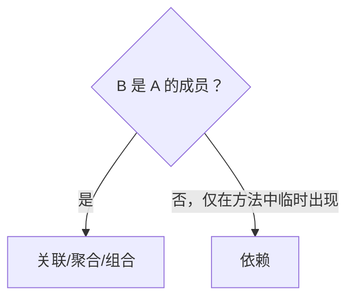

# 类的依赖关系

## 类的依赖关系

依赖（Dependency）是类与类之间**最弱、最临时**的一种关系：一个类在某个方法里“用到”另一个类，但后者不是前者的成员。典型表现是：`A` 的某个成员函数的**形参、返回值或局部变量**类型是 `B`。


为什么需要区分“依赖”和“关联”？因为它们的维护成本不同。关联（尤其组合/聚合）意味着对象内部长期持有另一个对象的引用，耦合度高；依赖则只是在一次方法调用期间产生联系，方法结束即消失。**能依赖就不关联**，是降低耦合的重要原则。

### 依赖的三种典型形式

| 形式 | 代码示例（B 出现在 A 的……） |
|------|------------------------------|
| 参数依赖 | `void A::setTimer(B* b)` |
| 返回值依赖 | `B* A::createB()` |
| 局部变量依赖 | `void A::work(){ B b; b.reset(); }` |

如果 `A` 中有数据成员 `B* pB` 或 `B b`，那就**不是依赖**，而是关联。

### 与关联的区别



> [!IMPORTANT]
> 判断标准：==看 B 是否作为 A 的数据成员存在==。是成员 → 关联（或更强）；只出现在成员函数的形参/返回值/局部变量中 → 依赖。

### 常见误区

> [!CAUTION]
> 有人认为“只要 A 用了 B 的方法就是依赖”。不对。如果 `A` 有一个 `B` 类型的成员变量并调用其方法，这属于**关联**而非依赖。

> [!WARNING]
> 依赖不代表“不创建对象”。局部变量依赖中 `A::work()` 内可以 `B b;` 创建 B 对象，但只要 b 不是 A 的成员，关系仍是依赖。

### 一个判对的例子

```cpp
class Timer;

class Task {
public:
    void schedule(Timer& t);   // 参数中出现 Timer → Task 依赖 Timer
};
```

分析：`Timer` 只出现在 `Task::schedule` 的形参类型里，`Task` 没有 `Timer` 类型的成员。因此这是**依赖关系**，不是关联。

再看一道典型题的分类：

| 代码片段 | 关系判定 |
|----------|----------|
| `class A { B b; };` | 组合（强关联） |
| `class A { B* pB; };` | 关联 |
| `void A::f(B* p){ ... }` | ==依赖== |
| `B& A::getB(){ ... }` | 依赖（返回值中出现 B） |

> [!TIP]
> 记忆口诀：**“成员为关联，参数返回局部为依赖”**。做题时先看类体内有没有对方类型的成员变量，没有就大概率是依赖。
