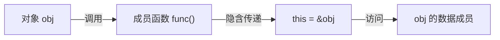

# 类的定义（成员数据、成员函数、访问属性public/private/protected）

## 类的定义与封装机制

类（Class）是面向对象程序设计的核心，是对具有共同特性的一组对象的抽象。它既包含表现静态属性的**数据成员**，又包含表现动态行为的**成员函数**。在 C++ 中，类实际上也是一种用户自定义类型。

> [!IMPORTANT]
> 类实现了**数据隐藏**与**封装**。通常将数据成员声明为 `private`，仅通过 `public` 成员函数间接访问，以确保数据安全。

### 访问控制属性

类成员有三种访问属性，决定了谁可以访问它们：

| 访问属性 | 含义 | 作用范围 |
| :--- | :--- | :--- |
| `private` | 私有成员 | 仅限**本类**成员函数及友元访问（默认属性） |
| `protected` | 保护成员 | 本类、友元及**派生类**成员函数可访问 |
| `public` | 公有成员 | 本类、友元及**类外部**代码均可访问 |

==核心结论==：`private` 是默认的访问属性；基类的 `private` 成员不能被派生类直接访问（即使对象中存在该空间）。

### 成员函数的实现方式

成员函数定义了对象的行为。其定义主要有两种方式：

1.  **类内定义**：直接在类体中定义。此时函数自动成为==内联函数==，适合短小简单的函数。
2.  **类外定义**：类体内只写原型，类体外实现。必须使用作用域解析运算符 `::` 指明归属。
    ```cpp
    // 类外定义格式
    返回类型 类名::成员函数名(参数表) { ... }
    ```

> [!WARNING]
> 在类定义中**不能**对数据成员进行初始化（静态常量除外）。初始化应在构造函数中完成。

### this 指针机制

每个非静态成员函数都有一个隐含的 `this` 指针，指向调用该函数的当前对象。
- 当对象 `obj` 调用成员函数时，系统自动传递 `&obj` 给 `this`。
- 在函数内部，访问数据成员等价于 `this->数据成员`。
- ==核心高亮==：`this` 指针使得不同对象调用同一成员函数时，操作的是各自独立的数据副本。



### 常见误区与辨析

- **构造函数与析构函数**：构造函数用于初始化，可重载；析构函数用于清理，无参数、无返回值，名为 `~类名`，且**有且只有一个**。
- **友元（Friend）**：友元函数/类不是类的成员，但被授予访问 `private/protected` 成员的权限。它破坏了封装性，但提高了灵活性（如运算符重载）。
- **常成员函数**：若函数不修改数据成员，应声明为 `const`。常对象只能调用常成员函数。

> [!TIP]
> 记忆口诀：私有的自己用，保护的子类用，公有的大家用。类外定义别忘加 `::`，默认私有要记清。

### 典型示例

以下代码展示了类的标准定义、`private` 数据隐藏及 `this` 指针的使用：

```cpp
class Point {
private:
    double x, y; // 私有数据，外部不可直接访问
public:
    // 构造函数
    Point(double x, double y) : x(x), y(y) {} 
    
    // 常成员函数，不修改对象状态
    double getX() const { 
        return this->x; // 显式使用 this，也可简写为 x
    }
    
    // 类外定义的成员函数原型
    void display();
};

// 类外实现
void Point::display() {
    cout << "(" << x << "," << y << ")" << endl;
}
