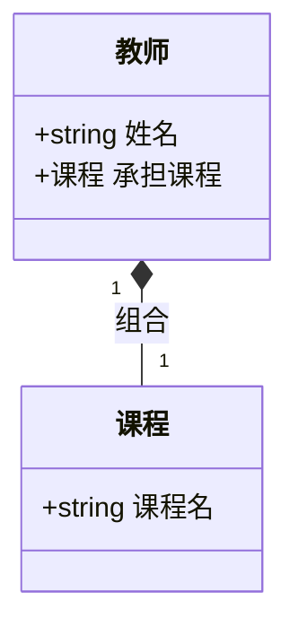
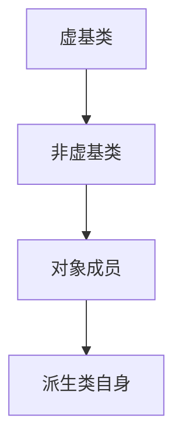

# 类的组合（对象成员）及构造与析构顺序

## 什么是类的组合

类的组合，是把其他类的对象作为当前类的数据成员。例如，“教师”类中包含一个“课程”对象、“学生”类中包含若干“图书”对象。它表达的是一种**整体—部分**关系：整体对象拥有部分对象，部分对象随整体对象一起生存。



组合与继承不同：继承描述“是什么”（is-a），组合描述“拥有什么”（has-a）。组合对象通常是成员对象，成员也可以独立拥有自己的状态和行为。

## 构造与析构顺序

对象成员在整体对象构造时创建，在整体对象析构时销毁，因此二者通常具有相同的生命周期。

> [!IMPORTANT]
> 构造整体对象时，先构造基类，再按声明顺序构造对象成员，最后构造派生类自身；析构顺序完全相反。

若存在虚基类，顺序为：

1. 最派生类先构造虚基类；
2. 构造非虚基类；
3. 构造对象成员；
4. 构造最派生类自身。

析构时则按相反次序进行。虚基类无论在继承链中出现多少次，都只构造一次。



> [!TIP]
> 记忆口诀：**虚基、非虚、成员、自己**；析构时全部倒过来。

## 如何给对象成员传参

对象成员的构造函数需要参数时，应在包含它的类的构造函数初始化列表中完成初始化：

```cpp
class Course {
public:
    Course(string name, int credit);
private:
    string name;
    int credit;
};

class Teacher {
public:
    Teacher(string t, string c, int n);
private:
    string name;
    Course course;  // 对象成员
};

Teacher::Teacher(string t, string c, int n)
    : name(t), course(c, n) {
    // 构造函数体
}
```

这里，`course(c, n)` 调用 `Course` 的构造函数。

> [!WARNING]
> 初始化列表中的书写次序不会改变实际构造次序。对象成员仍按它们在类中的**声明顺序**构造。

## 一个算对了的例子

```cpp
class A { };
class B { };

class C : public A {
    B b;
    A a;
};
```

定义 `C` 对象时：

1. 构造直接基类 `A`；
2. 构造对象成员 `b`；
3. 构造对象成员 `a`；
4. 构造 `C` 自身。

所以顺序是：

```text
A（基类）→ B（成员）→ A（成员）→ C（自身）
```

对应选项为 **A**。

> [!CAUTION]
> 不要把初始化列表的排列顺序当成构造顺序，也不要认为“同名成员和基类只能构造一次”。基类 `A` 与对象成员 `a` 是两个不同对象，都会分别构造。
