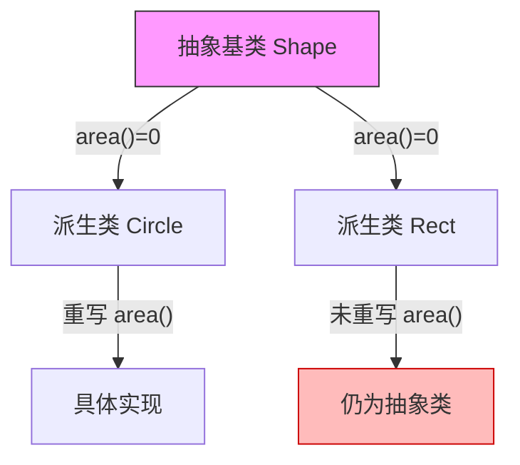

# 纯虚函数的定义

如果基类只负责定义接口规范，而无法给出具体实现，我们该如何强制派生类必须重写该函数？普通的虚函数虽然允许重写，但无法阻止派生类“偷懒”直接继承基类的空实现。此时就需要一种更严格的机制来约束继承体系。

## 纯虚函数的定义与语法

> [!IMPORTANT]
> ==纯虚函数是在基类中声明但没有定义的虚函数==，它仅作为接口占位符，要求任何非抽象派生类都必须提供自己的版本。

其声明格式具有两个关键特征：以 `virtual` 开头，以 `=0;` 结尾。注意 `=0` 并非赋初值，而是告诉编译器“此函数无本体”。

```cpp
class Shape {
public:
    // 纯虚函数：只有声明，没有实现
    virtual double area() const = 0; 
};
```

包含至少一个纯虚函数的类被称为==抽象类==。抽象类不能实例化对象，但可以定义指针和引用，这是实现动态多态性的基础。

## 与普通虚函数的核心区别

| 特性 | 普通虚函数 | 纯虚函数 |
| :--- | :--- | :--- |
| 基类实现 | 必须有函数体 | 不能有函数体（`=0`） |
| 派生类重写 | 可选（可继承基类版本） | ==必须重写==（否则仍为抽象类） |
| 所在类性质 | 可以是具体类 | 必然是抽象类 |
| 设计意图 | 提供默认行为+可扩展 | 仅定义接口契约 |



> [!WARNING]
> 若派生类未重写所有纯虚函数，则该派生类==自动成为新的抽象类==，同样不能创建对象。这是考试高频陷阱。

## 典型考题解析

回顾经典选择题：“是一个在基类中说明的虚函数，它在该基类中没有定义，但要求任何派生类都必须定义自己的版本”，正确答案是==纯虚函数==。

再看关于抽象类的判断题：
-   **A. 不能定义抽象类的对象** ✅ 正确，抽象类只能作基类或通过指针/引用使用。
-   B. 不能从抽象类派生出新类 ❌ 抽象类的核心价值就是被继承。
-   C. 抽象类没有构造函数 ❌ 抽象类可以有构造函数，供派生类构造时调用。
-   D. 数据成员必须是抽象数据类型 ❌ 无任何此限制。

> [!TIP]
> 记忆口诀：==纯虚等于零，抽象禁实例；派生若不写，继续当抽象==。解题时看到 `=0` 立即反应“抽象类+强制重写”。

## 常见误区警示

> [!CAUTION]
> 纯虚函数的 `=0` 后面是分号，不是花括号 `{}`。写成 `virtual void f() = 0 {}` 在某些编译器下虽合法但语义混乱，考试中视为错误写法。

另外，抽象类虽然不能直接创建对象，但其==指针可以指向派生类对象==，这正是教材例6.13演示的动态多态核心用法。通过基类指针调用 `area()` 时，运行时会根据实际对象类型执行对应派生类的重写版本，而非基类的纯虚声明。
