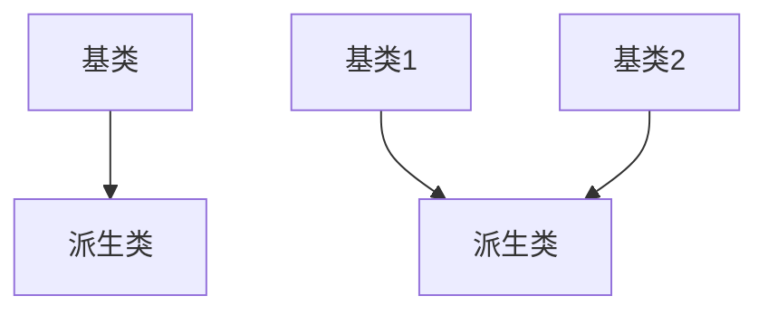

# 基类与派生类、单一继承与多重继承

在面向对象程序设计中，继承允许新类复用旧类已定义的属性和操作。其中，旧类称为**基类（父类）**，新类称为**派生类（子类）**。通过继承，派生类可以复用基类的代码，并增加新的数据成员和成员函数。

## 单一继承与多重继承

根据直接基类数目的不同，继承分为两类：

| 类型 | 含义 | 定义形式 |
|---|---|---|
| 单一继承 | 派生类只有一个直接基类 | `class B: public A { ... };` |
| 多重继承 | 派生类有多个直接基类 | `class D: public A, public B, public C { ... };` |

派生类定义的一般形式为：

```cpp
class 派生类名: [继承方式] 基类名1
              , [继承方式] 基类名2, ...
{
    // 派生类新增的数据成员和成员函数
};
```

多重继承中，各基类之间用逗号分隔。继承方式可以是 `public`、`protected` 或 `private`，其中==公有继承最常用==。



## 基类成员在派生类中的访问属性

继承方式会影响基类成员在派生类中的访问属性：

| 基类成员属性 | `public` 继承 | `protected` 继承 | `private` 继承 |
|---|---|---|---|
| `public` | `public` | `protected` | `private` |
| `protected` | `protected` | `protected` | `private` |
| `private` | 派生类不可直接访问 | 派生类不可直接访问 | 派生类不可直接访问 |

> [!IMPORTANT]
> 基类的 `private` 成员仍占据派生类对象的存储空间，但派生类成员函数不能直接访问，只能通过基类提供的公有或保护成员函数间接访问。

例如：

```cpp
class Person {
private:
    int age;
protected:
    int id;
public:
    void setAge(int a) { age = a; }
};

class Student : public Person {
public:
    void f() {
        id = 1;          // 正确：可访问基类 protected 成员
        // age = 20;     // 错误：不能直接访问基类 private 成员
        setAge(20);      // 正确：通过基类公有函数间接访问
    }
};
```

只有基类的 `public` 成员经过公有继承后仍为 `public`，才能通过派生类对象直接访问，如 `obj.show()`。此外，==派生类的对象也不能直接访问基类的保护成员==，保护成员需要在类内部通过成员函数访问。

## 派生类对象的构造与析构

定义派生类对象时，构造函数的调用顺序为：

1. 虚基类构造函数；
2. 非虚基类构造函数；
3. 派生类对象成员的构造函数；
4. 派生类自身构造函数。

析构函数的调用顺序与构造顺序相反。

若基类构造函数需要参数，派生类应通过初始化列表向基类传递参数：

```cpp
class Vehicle {
protected:
    int MaxSpeed;
public:
    Vehicle(int m) : MaxSpeed(m) {}
};

class Car : public Vehicle {
    int SeatNum;
public:
    Car(int m, int s) : Vehicle(m), SeatNum(s) {}
};
```

多重继承时，基类构造函数按照==派生类定义中基类的声明顺序==调用，而不是按照初始化列表中的书写顺序调用。

## 同名成员与虚基类

继承中常见的同名问题有三种：

- 派生类与基类有同名成员：派生类成员覆盖基类同名成员，可用 `基类名::成员名` 访问基类版本。
- 多个直接基类有同名成员：会产生二义性，可用 `基类名::成员名` 指定来源。
- 多个继承路径共享同一祖先基类：可能产生祖先成员的多份拷贝，可将共同祖先声明为虚基类。

```cpp
class B : virtual public A { };
class C : public virtual A { };
```

`virtual` 的位置可以在继承方式之前或之后。虚基类能够保证共同祖先在最终派生类对象中只有一份，并且其构造函数至多调用一次。

> [!WARNING]
> 对多份祖先成员进行限定时，不能只写共同祖先类名，因为无法确定访问的是哪一份拷贝；应指明中间基类，或者使用虚基类消除多份拷贝。

## 公有派生类的赋值兼容

公有派生类可以看作一种特殊的基类，因此需要基类对象的地方，可以使用公有派生类对象代替：

```cpp
Base b;
Derived d;
b = d;          // 派生类对象赋给基类对象
Base *p = &d;   // 派生类对象地址赋给基类指针
Base &r = d;    // 派生类对象初始化基类引用
```

赋值兼容的方向是：==左边为基类对象、指针或引用，右边为公有派生类对象或其地址==。反向赋值通常不成立，因为基类对象不包含派生类新增的成员。这一规则也是后续利用基类指针或引用实现动态多态性的基础。
