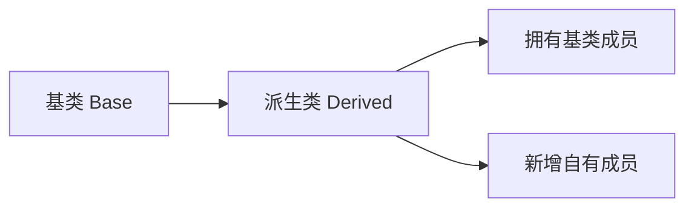

# 继承性

## 它是什么

在面向对象程序设计中，==三大突出特征是：封装性、继承性和多态性==；有些教材把“抽象”也并列进来，形成四大特征：抽象、封装、继承、多态（南邮考题常考，填空时顺序可互换）。

**继承性**是第二大特征。一句话说清：

> 派生类通过 **继承** 机制获得基类已定义的属性和操作。

也就是说，如果已经写好了“基类”（父类），那么“派生类”（子类）不必从零重写，直接拿了基类的成员来用，还可以再补充自己的新成员。



## 为什么需要

假如没有继承，每定义一个新类都要把公共属性和操作抄一遍：重复代码多、改一处要改多处、容易写错。继承的核心目的就是——==提高代码重用性==。

这也是课件里反复出现的原话：继承性是“面向对象程序设计的第二大特征，是提高代码重用性的重要措施”。

## 怎么做（语法骨架）

在 C++ 里，典型写法是：

```cpp
class Base {
protected:
    int x;
public:
    void setX(int v) { x = v; }
};

class Derived : public Base {   // 继承
public:
    void show() { /* 可用 x、setX */ }
};
```

`Derived` 继承了 `Base` 的成员。注意访问控制：上面的考题里有一道很易错的题——

> [!WARNING]
> **派生类的“对象”不能直接访问基类的 `protected` 成员**，只能通过派生类的成员函数或友元间接访问。

用表格记住谁可以访问基类的 `protected` 成员：

| 访问者 | 能否访问基类 `protected` |
|---|---|
| 基类成员函数 | 能 |
| 基类友元函数 | 能 |
| 公有派生类成员函数 | 能 |
| **派生类的对象** | **不能** |

所以考卷里那道“下列哪一项不能访问基类的保护成员”，答案是 **B. 派生类的对象**。

## 和相近概念的区别

- **继承 vs 封装**：封装是把数据和行为包进类里并隐藏细节；继承是类之间“复用已有类”的关系。
- **继承 vs 多态**：继承解决“复用”，多态解决“同一接口、多种实现”的动态绑定；多态通常要建立在继承之上。

## 一个算对了的例子

题目：在面向对象的程序设计中，派生类通过 ① 机制获得基类已定义的属性和操作。

你会怎么填？先想：子类拿到父类的成员，靠的是“父子关系”的建立方式——就是 **继承**。

因此答案：

> ① ==继承==

> [!TIP]
> 记忆口诀：`封装打包、继承复用、多态变形`；看到“派生类获得基类成员”立刻写“继承”。
