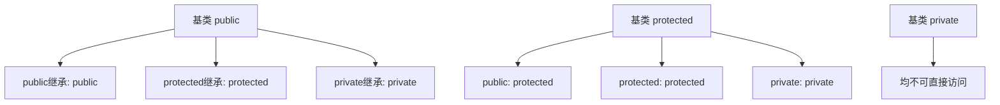

# 公有继承、保护继承与私有继承及访问权限总结

## 它是什么

在 C++ 中，派生类继承基类时，可选用 `public`、`protected`、`private` 三种继承方式。它们决定了基类成员进入派生类后的“新身份”，也决定了类外能否访问。

先看一个小问题：如果基类有一个 `public` 成员函数 `show()`，用不同方式继承后，还能不能通过派生类对象写 `obj.show()`？答案就藏在继承方式里。

## 三种继承方式怎么做

- ==公有继承==：`基类的 public 成员和 protected 成员在派生类中属性不变，private 成员不可直接访问==。类外可以通过派生类对象调用原 `public` 成员，如课件例 5.4 中的 `obj.show()`。
- ==保护继承==：基类 `public` 和 `protected` 成员都变成派生类的 `protected`，类外不能访问，只能在派生类及其再派生类中用。
- ==私有继承==：基类 `public` 和 `protected` 成员都变成派生类的 `private`，只有本派生类内部能直接用。
- 若定义派生类时缺省继承方式，如 `class B : A`，则默认为 `private` 继承（南邮考题选 8 答案 C）。



> [!IMPORTANT]
> 派生类新增成员函数不可直接访问基类的 `private` 成员，无论哪种继承。如考题：类 X 中 `int a,b;` 私有，Y 公有继承 X，`Y::fy(){ c=a*b; }` 非法（答案 B）。

## 为什么需要

不同方式表达不同“关系强度”。公有继承表示“派生类是一种基类”（is-a），也是实现动态多态性的前提——课件指出动态多态性靠 ==公有继承、虚函数、基类指针或引用== 共同实现。保护/私有继承更像“复用实现”，不暴露接口。

## 相近概念区别

| 继承方式 | 基类 public 在派生类 | 基类 protected 在派生类 | 类外访问原 public |
|--------|------------------|---------------------|--------------|
| public | public | protected | 可以 |
| protected | protected | protected | 不可以 |
| private | private | private | 不可以 |

## 常见的坑

> [!WARNING]
> 私有成员不是“不存在”，对象空间里仍有基类 private 成员，只是派生类不能直接碰。
> 单选 6 中，`A aa,*pa=&aa; B bb,*pb=&bb;` 且 B 公有继承 A，赋值兼容仅允许 `aa=bb`（基类对象接收派生类切片），不能 `bb=aa` 或指针反向赋值，故答案为 C。

## 一个算对了的例子

```cpp
class A {
    int x;              // private
public:
    void showA(){ }
protected:
    void proA(){ }
};
class B : public A {    // 公有继承
public:
    void f(){
        showA();        // OK：public 成员性质不变
        proA();         // OK：protected 仍可见
        // x = 1;        // 非法：private 不可访问
    }
};
// B obj; obj.showA(); // OK：类外可直接访问
```

掌握这张“属性变化表”和缺省规则，第 5 章类与类之间关系的继承大题就能稳拿。
