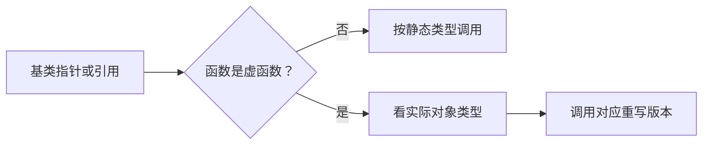

# 虚函数的定义以实现动态多态性及虚函数的限制

## 为什么需要虚函数

先看一个“名字一样，结果却不同”的问题：

```cpp
Base *p = new Derived;
p->show();       // 希望调用 Derived::show()
delete p;        // 还希望先执行派生类析构，再执行基类析构
```

如果 `show()` 只是普通成员函数，编译器通常按**指针的静态类型** `Base*` 决定调用 `Base::show()`，这叫静态联编。把基类中的 `show()` 声明为虚函数后，程序在运行时根据 `p` **实际指向对象的动态类型**选择函数，实现动态多态性。

> [!IMPORTANT]
> ==动态多态性的典型条件是：公有继承、派生类重写基类虚函数、通过基类指针或引用调用。==只定义同名函数，并不一定能实现动态多态。

## 定义与使用

在基类成员函数声明前加 `virtual`：

```cpp
#include <iostream>
using namespace std;

class Shape {
public:
    virtual double area() const {
        return 0;
    }
    virtual ~Shape() = default; // 基类析构函数常声明为虚函数
};

class Circle : public Shape {
    double r;
public:
    explicit Circle(double r) : r(r) {}
    double area() const override {
        return 3.1415926 * r * r;
    }
};

int main() {
    Circle c(2);
    Shape *p = &c;
    cout << p->area() << endl; // 调用 Circle::area()
}
```

输出约为 `12.5664`。这里 `p` 的静态类型是 `Shape*`，动态类型是 `Circle`，所以调用派生类版本。派生类函数一旦正确重写基类虚函数，它本身也是虚函数，即使不写 `virtual`；建议写 `override`，让编译器检查签名是否真的匹配。



## 与相近概念的区别

| 概念 | 决定调用的时机 | 关键手段 |
|---|---|---|
| 函数重载 | 编译时 | 同一作用域中参数列表不同 |
| 运算符重载 | 编译时 | 重载运算符函数 |
| 虚函数重写 | 运行时 | 基类声明 `virtual`，派生类保持相同函数签名 |
| 同名隐藏 | 通常编译时 | 派生类同名函数隐藏基类版本，不等于重写 |

重载看的是**参数不同**，重写看的是**继承关系中的同一接口**。通过对象本身调用，如 `c.area()`，对象类型已经明确，不需要借助基类指针体现动态多态。

## 虚函数的限制与常见坑

- 虚函数必须是**非静态成员函数**。静态成员函数不依赖具体对象，没有 `this` 指针，不能声明为虚函数。
- **构造函数不能是虚函数**。构造对象时，动态类型和对象尚在建立过程中。
- **普通全局函数、友元函数不能声明为虚函数**。友元函数本身不是类的成员；但友元函数体内可以通过基类指针或引用调用虚函数。
- 析构函数可以声明为虚函数。若可能通过基类指针 `delete` 派生类对象，基类析构函数通常应声明为 `virtual`，否则行为未定义。
- 仅写 `virtual` 不够：派生类函数若参数类型、const 限定等不一致，就可能不是重写。`override` 能帮助发现这类错误。
- 构造函数和析构函数执行期间调用虚函数，不会按通常方式派发到“尚未构造”或“已经析构”的派生部分。

> [!WARNING]
> 选择题中“析构函数常声明为虚函数”是一般设计建议，不等于“所有析构函数都必须为虚函数”；“虚函数不能是友元函数”才是对声明限制的准确表述。

## 考题示例

题目：下列哪一项能声明为虚函数？  
A. 静态函数　B. 友元函数　C. 构造函数　D. 析构函数

正确答案是 **D**。静态函数和友元函数不是可动态派发的非静态成员函数，构造函数不能为虚函数，只有析构函数可以。

> [!TIP]
> 记忆：**构造不能虚，静态不能虚，友元不能虚；析构可以虚，而且基类常需要虚析构。**
