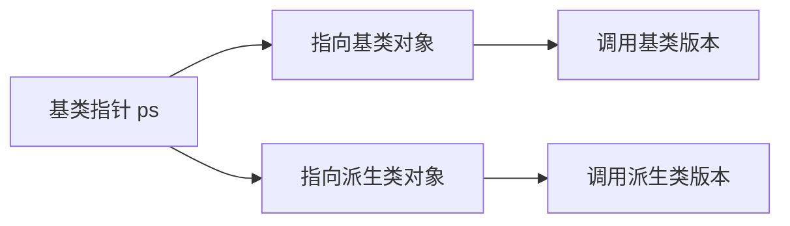

# 虚函数与同名覆盖问题

## 虚函数与同名覆盖

### 它是什么

在 C++ 中，当基类指针或引用指向派生类对象时，普通成员函数的调用在**编译期**就确定了——调的是基类版本。虚函数（virtual function）改变了这一规则：如果基类中某个成员函数被声明为 `virtual`，且派生类中提供了**函数原型完全一致**的同名函数，那么通过基类指针或引用调用该函数时，实际执行的是**对象真正所属类型**的版本。这就是动态多态性。



> [!IMPORTANT]
> 虚函数实现动态多态性需要三个条件同时满足：==公有继承==、==基类指针或引用调用==、==派生类中函数原型与基类虚函数完全一致==（返回值类型、函数名、形参表都相同）。

### 为什么需要

设想一个绘图程序：基类 `Shape` 有 `Draw()`，派生类 `Circle`、`Rectangle` 各有自己的绘制方式。如果 `Draw()` 不是虚函数，当用 `Shape*` 遍历所有图形并调用 `Draw()` 时，画出来的永远是基类的空实现。有了虚函数，一条 `ps->Draw()` 就能根据对象的真实类型画出圆或矩形——代码不需要为每种图形写分支判断。

```cpp
class Shape {
public:
    virtual void Draw() { cout << "绘制基类图形" << endl; }
};
class Circle : public Shape {
public:
    void Draw() { cout << "绘制圆形" << endl; }
};
class Rectangle : public Shape {
public:
    void Draw() { cout << "绘制矩形" << endl; }
};

Shape* ps;
Circle c;  Rectangle r;
ps = &c;  ps->Draw();   // 输出：绘制圆形
ps = &r;  ps->Draw();   // 输出：绘制矩形
```

### 同名覆盖：虚函数失效的情形

虚函数要求**函数原型完全一致**。如果派生类中的同名函数在返回值类型或形参表上与基类虚函数有任何差别，即使前面也写了 `virtual`，它也不再是基类虚函数的“重写版本”，而是**另起炉灶的一个新函数**。此时通过基类指针调用，执行的仍然是基类版本。

```cpp
class Base {
public:
    virtual void f1() { cout << "Base::f1()" << endl; }
    virtual void f2(int x) { cout << "Base::f2(int)" << endl; }
};
class Derived : public Base {
public:
    void f1() { cout << "Derived::f1()" << endl; }        // ✓ 原型一致，具有多态性
    void f2(double x) { cout << "Derived::f2(double)" << endl; }  // ✗ 形参类型不同，同名覆盖
};

Base* p = new Derived();
p->f1();          // 输出：Derived::f1()  —— 多态生效
p->f2(3.14);      // 输出：Base::f2(int)   —— 多态失效，调的是基类版本
```

注意 `f2` 的情况：`p->f2(3.14)` 时编译器根据**基类指针的静态类型**在 `Base` 中找 `f2`，只找到 `f2(int)`，于是把 `3.14` 隐式转换为 `int` 后调用基类版本。派生类的 `f2(double)` 被“遮蔽”了。

> [!WARNING]
> 派生类中写了参数不同的同名函数，编译器不会认为你在“重写”基类虚函数，而是新定义了一个函数。此时基类的同名函数在派生类中被==隐藏==，直接通过派生类对象调用 `d.f2(5)` 也会报错，除非显式 `d.Base::f2(5)`。

### 虚函数的限制

| 函数类型 | 能否声明为虚函数 | 原因 |
|---|---|---|
| 静态成员函数 | ✗ | 不属于任何对象，没有 this 指针，无多态性 |
| 内联成员函数 | ✗ | 内联要求编译期展开，与运行时多态矛盾 |
| 构造函数 | ✗ | 对象尚未创建完毕，虚机制无从谈起 |
| 析构函数 | ✓（建议） | 保证用基类指针 delete 派生类对象时正确析构 |

> [!TIP]
> 记法：**“静、内、构”不能虚，析构建议虚**。静态无对象、内联要展开、构造没建完——都和多态“运行时看真实类型”的机制冲突。

### 纯虚函数与抽象类

有时基类中的虚函数根本没有合理的默认实现——比如 `Shape::Draw()` 画什么？这时将它声明为**纯虚函数**：

```cpp
virtual void Draw() = 0;   // 注意末尾的 “= 0”
```

含有至少一个纯虚函数的类称为**抽象类**。抽象类不能实例化对象，但可以定义指针和引用，这正是动态多态性的用武之地：

```cpp
class Shape {           // 抽象类
public:
    virtual void Draw() = 0;
    virtual double Area() = 0;
};
Shape* ps;              // ✓ 可以定义指针
Shape s;                // ✗ 编译错误：不能定义抽象类对象
```

派生类必须实现所有纯虚函数，才能成为一个“具体类”并实例化。如果只实现了部分，派生类仍然是抽象类。

> [!NOTE]
> 纯虚函数 ≠ 没有实现的虚函数。`virtual void f() = 0;` 是**语法上明确声明“此函数必须由派生类实现”**，而 `virtual void f() {}` 是一个有函数体（哪怕为空）的虚函数，派生类可以不重写。

### 一个完整的例子

```cpp
#include <iostream>
using namespace std;

class Vehicle {
protected:
    int MaxSpeed, Weight;
public:
    Vehicle(int m, int w) : MaxSpeed(m), Weight(w) {}
    virtual void Show() {   // 声明为虚函数
        cout << "Max speed: " << MaxSpeed << endl;
        cout << "Weight: " << Weight << endl;
    }
    virtual ~Vehicle() {}   // 析构函数建议声明为虚函数
};

class Car : public Vehicle {
private:
    int SeatNum;
public:
    Car(int m, int w, int s) : Vehicle(m, w), SeatNum(s) {}
    void Show() override {  // 函数原型与基类完全一致，多态生效
        Vehicle::Show();    // 调用基类版本输出公共信息
        cout << "Seat number: " << SeatNum << endl;
    }
};

int main() {
    Vehicle* pv;
    Car car(200, 1500, 5);
    pv = &car;
    pv->Show();   // 运行时确定调用 Car::Show()
    return 0;
}
```

**输出：**

```text
Max speed: 200
Weight: 1500
Seat number: 5
```

如果删掉 `virtual` 关键字，`pv->Show()` 将永远只输出 `Max speed` 和 `Weight`，第三行不会出现——这就是虚函数与同名覆盖最直观的差异。
