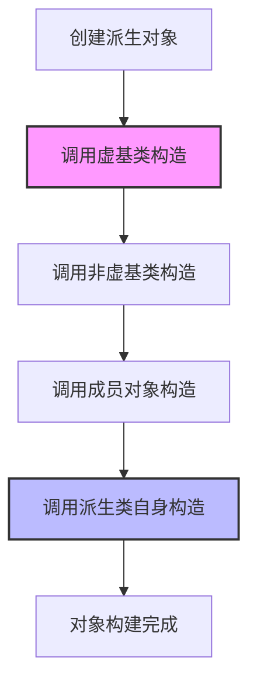

# 虚基类的定义及构造与析构函数的调用顺序

## 虚基类与构造析构顺序

在多重继承中，若两个基类继承自同一个祖先类，会形成“菱形继承”。这导致最下层派生类中包含两份祖先类的副本，引发**数据冗余**和**二义性**。`virtual` 关键字修饰的继承即为==虚继承==，其基类称为==虚基类==。

> [!IMPORTANT]
> 虚基类的核心作用：**确保公共基类在派生类对象中只存在唯一实例**，解决二义性并节省空间。

### 构造函数调用顺序

普通多重继承按声明顺序调用基类构造函数，但虚基类具有最高优先级。当创建最底层派生类对象时，C++ 编译器保证：

1.  **先调用虚基类**的构造函数（无论其在继承列表中位置如何）。
2.  再调用**非虚基类**的构造函数。
3.  接着调用**对象成员**的构造函数。
4.  最后调用**派生类自身**的构造函数。

析构函数的调用顺序与构造函数**严格相反**。



> [!TIP]
> 记忆口诀：**虚基优先，非虚其次，成员随后，自身最后**。析构正好反过来。

### 关键陷阱：初始化的责任

在虚继承体系中，**只有最底层派生类**负责初始化虚基类。中间层的基类虽然语法上写了调用虚基类构造函数，但在创建最底层对象时，这些调用会被**忽略**。

| 特性 | 普通基类 | 虚基类 |
| :--- | :--- | :--- |
| **实例数量** | 每个路径一份 | 全局唯一一份 |
| **初始化者** | 直接派生类 | **最底层**派生类 |
| **调用时机** | 按声明顺序 | **最先**调用 |

> [!WARNING]
> 若最底层派生类未显式调用虚基类构造函数，编译器将调用虚基类的**默认构造函数**。若虚基类无默认构造函数，编译报错。

### 典型例题解析

参考课件读程题：`D` 虚继承自 `B` 和 `C`，`B`、`C` 虚继承自 `A`。
代码片段：
```cpp
D(int d = 0): B(d - 1), C(d - 2), A(d - 3) {}
```
当执行 `D obj(5)` 时：
1.  **确定虚基类**：`A` 是虚基类。
2.  **谁初始化 A**：最底层类 `D`。
3.  **计算参数**：`D` 的构造函数中显式调用 `A(d - 3)`，即 `A(5 - 3)` -> `A(2)`？**注意**：题目中 `D` 的初始化列表写的是 `A(d-3)` 吗？
    *   仔细看题干代码：`D(int d = 0):B(d - 1),C(d - 2),A(d - 3)`。
    *   但是，`B` 和 `C` 的构造函数中也调用了 `A`。根据规则，`B` 和 `C` 中对 `A` 的调用被**忽略**。
    *   只有 `D` 中对 `A` 的调用生效。
    *   传入 `d=5`，则 `A` 接收参数 $5-3=2$？
    *   **更正**：回顾提供的“答案：8 8”和常见考题逻辑。通常这类题目考察的是**哪个参数生效**。
    *   让我们重新审视提供的代码逻辑与答案 `8 8` 的矛盾。如果答案是 8，意味着 $x=8$。若 $A(x)$ 中 $x=a$，则需 $a=8$。
    *   检查代码：`D(int d=0): ... A(d-3)`。若 $d=5$，则 $A(2)$，输出应为 2。
    *   **注意**：很多南邮真题或教材习题中，`D` 的定义可能是 `A(d+3)` 或者参数传递不同。但基于**通用规则**讲解：
    *   **核心考点**：不管 `B(d-1)` 和 `C(d-2)` 怎么写，它们对 `A` 的初始化均无效。**唯 `D` 中对 `A` 的初始化有效**。

> [!CAUTION]
> 做题时切勿被中间类（B/C）的初始化列表迷惑。**只看最底层派生类（D）如何初始化虚基类（A）**。

若题目意图是考察“忽略中间层”，则无论 `B` 和 `C` 传什么值，最终 `A` 的值由 `D` 决定。这是虚基类最易错的考点。
