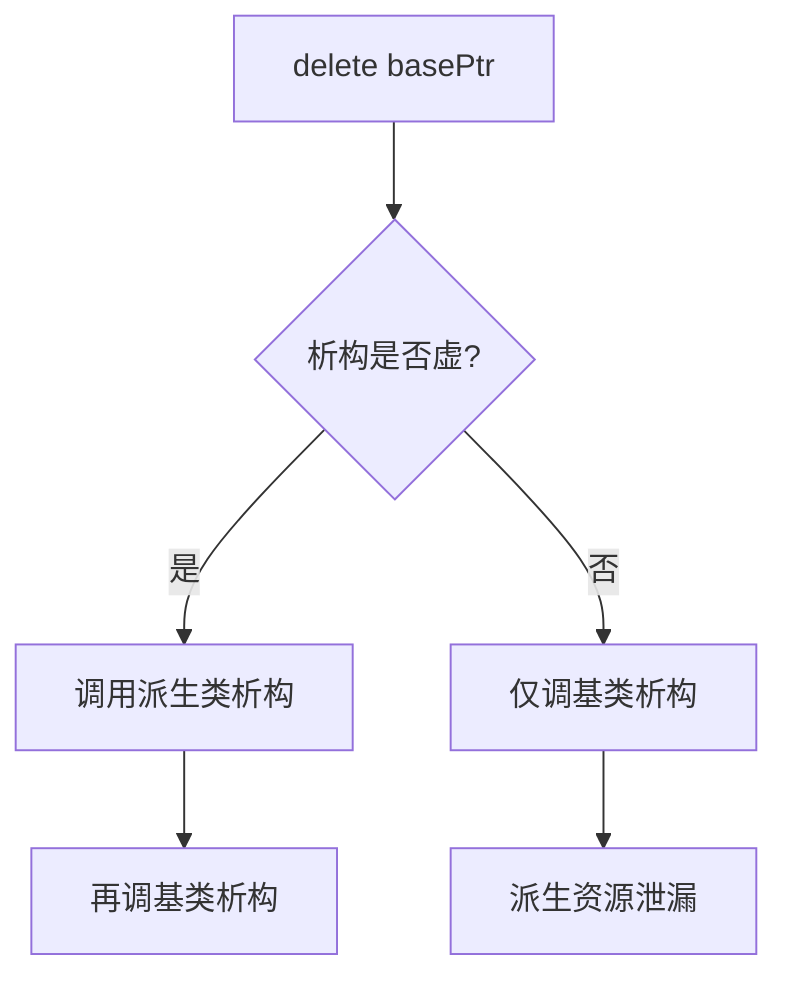

# 虚析构函数的作用与定义

## 虚析构函数是什么

在 C++ 多态机制中，==虚析构函数是将基类析构函数声明为 `virtual` 的特殊成员函数==。它解决了一个关键问题：当通过基类指针删除派生类对象时，如何确保派生类的析构函数也被正确调用。

思考一下：如果基类析构函数不是虚函数，执行 `delete basePtr;` 时会发生什么？编译器只会根据指针的静态类型（基类）决定调用哪个析构函数，导致派生类特有的资源释放代码被跳过，造成内存泄漏或未定义行为。

> [!IMPORTANT]
> 只要一个类可能被继承且通过基类指针管理生命周期，其析构函数就应声明为虚函数。这是实现安全多态的必要条件。

## 为什么需要虚析构函数

普通析构函数不具备多态性。若基类析构非虚，则 `delete` 操作仅触发基类析构，派生类部分“静默丢失”。这在涉及动态内存、文件句柄等资源时尤为危险。



> [!WARNING]
> 即使基类本身无需清理资源，只要预期被继承并多态使用，仍须定义虚析构函数（可为空实现），否则派生类析构永远不会被自动调用。

## 如何定义虚析构函数

语法与普通虚函数一致，在析构函数前加 `virtual` 关键字：

```cpp
class Base {
public:
    virtual ~Base() { /* 基类清理 */ }
};

class Derived : public Base {
public:
    ~Derived() override { /* 派生类清理 */ } // override 可选但推荐
};
```

使用时通过基类指针删除对象即可触发完整析构链：

```cpp
Base* p = new Derived();
delete p; // 先调 ~Derived()，再调 ~Base()
```

> [!TIP]
> 派生类析构函数无需重复写 `virtual`，但建议加 `override` 以增强可读性和编译期检查。

## 与相关概念的区别

| 特性             | 虚析构函数               | 普通析构函数           | 纯虚析构函数         |
|------------------|--------------------------|------------------------|----------------------|
| 是否支持多态     | 是                       | 否                     | 是                   |
| 能否有默认实现   | 可以                     | 可以                   | **必须提供定义**     |
| 抽象类判定       | 不使类成为抽象类         | 不使类成为抽象类       | 使类成为抽象类       |
| 典型使用场景     | 多态基类                 | 最终类或非多态基类     | 接口类需自定义析构   |

> [!NOTE]
> 纯虚析构函数虽声明为 `=0`，但仍需在类外提供函数体，因为派生类析构完成后会自动调用基类析构。

## 常见误区与真题辨析

> [!CAUTION]
> 虚函数必须是成员函数，不能是友元或静态成员；析构函数常被声明为虚函数，但并非所有虚函数都是析构函数。

回顾真题：  
**“下面对虚函数描述正确的是（ ）”**  
选项 A “析构函数常声明为虚函数” ✅ 正确——这正是虚析构函数的核心应用场景。  
选项 C “虚函数不能是友元函数”也正确，但题目单选且 A 更贴合本章重点。结合课件强调“虚析构用于安全删除”，A 为最佳答案。

> [!IMPORTANT]
> ==虚析构函数的核心价值在于保障多态删除的安全性==，而非功能扩展。设计基类时，若存在任何公有派生可能，优先将其析构设为虚函数。
