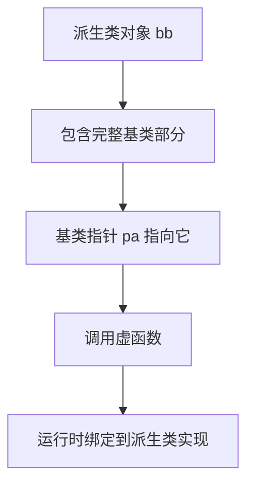

# 赋值兼容规则（派生类对象赋给基类对象/指针/引用）

## 赋值兼容规则

派生类是在基类基础上扩展而来，因此一个公有派生类对象**本身就是**一个基类对象（它包含了完整的基类部分）。基于这一事实，C++ 规定了赋值兼容规则：**赋值号左边是基类对象（指针、引用），右边可以是公有派生类对象（指针、引用），反之不然。**

## 四种合法形式

| 形式 | 示例 | 说明 |
|---|---|---|
| 基类对象 = 派生类对象 | `aa = bb;` | 仅复制基类部分，派生类新增部分被"切割" |
| 基类指针 = 派生类对象地址 | `pa = &bb;` | 基类指针指向派生类对象中的基类子对象 |
| 基类指针 = 派生类指针 | `pa = pb;` | 同上，本质是地址的向上转换 |
| 基类引用 = 派生类对象 | `A &ra = bb;` | 引用绑定到派生类对象中的基类子对象 |

> [!IMPORTANT]
> 赋值兼容的前提是**公有派生**。只有 `public` 继承下，派生类才保持了基类的完整接口，才能安全地当作基类使用。

## 为什么需要

思考一个问题：如果有一个处理基类对象的通用函数（如 `void show(A &obj)`），能否让它同时处理派生类对象？

答案是可以——利用赋值兼容规则，把派生类对象传给基类引用即可。这正是**动态多态性**（运行时多态性）的基础：通过 `公有继承 + 虚函数 + 基类指针/引用`，让同一段代码根据对象的实际类型执行不同行为。



## 常见误区与边界

> [!WARNING]
> 以下操作均**不合法**：
> - `pb = pa;`（基类指针 → 派生类指针）
> - `bb = aa;`（基类对象 → 派生类对象）
> - `B &rb = aa;`（基类对象 → 派生类引用）

原因很简单：派生类对象比基类对象"大"，基类对象缺少派生类新增的成员，强行赋值会导致这些成员处于未定义状态。

> [!CAUTION]
> 虽然可以通过强制类型转换 `pb = (B*)pa;` 让基类指针指向派生类指针，但只有当 `pa` 实际指向的确实是派生类对象时才安全，否则是未定义行为。考试中默认不允许这种反向转换。

## 典型例题

设类 B 是基类 A 的公有派生类，并有：

```cpp
A aa, *pa = &aa;
B bb, *pb = &bb;
```

则正确的语句是（ ）

- A. `pb = pa;`  ← 反向赋值，错误
- B. `bb = aa;`  ← 反向赋值，错误
- C. `aa = bb;`  ← ✓ 基类对象 = 派生类对象，合法
- D. `*pb = *pa;`  ← 本质是 `bb = aa`，错误

**答案：C**

`aa = bb` 执行时，编译器将 `bb` 中属于基类的成员逐一复制给 `aa`，而 `bb` 中派生类特有的成员被忽略。这一过程称为"**对象切割**"（object slicing）。如果后续通过 `pa` 调用虚函数，由于 `pa` 指向的是基类对象 `aa`，不会发生动态绑定——只有 `pa = &bb` 时，多态才真正生效。
