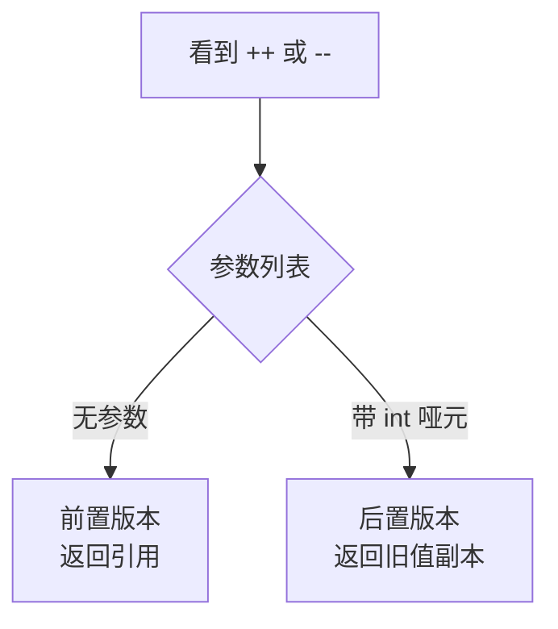

# 运算符重载的定义规则与定义形式

## 是什么：让运算符对自定义类型也"会说话"

运算符重载的本质是**函数重载**：给已有的运算符（`+`、`-`、`<<` 等）赋予新的含义，使其能作用于类的对象。例如 `a + b` 原本只能用于数值，重载后可以直接实现两个 `Complex` 复数对象、两个 `Matrix` 矩阵对象的相加。

> [!IMPORTANT]
> 运算符重载是**静态多态性**（编译时多态）的实现方式之一，与虚函数实现的**动态多态性**（运行时多态）相对。编译器在编译期根据操作数类型确定调用哪个重载函数。

## 为什么需要：自然表达，可读性至上

如果没有运算符重载，复数加法只能写成 `c3 = c1.add(c2)` 这样的函数调用，既不直观也不符合数学习惯。重载后写成 `c3 = c1 + c2`，代码更贴近问题域的抽象层次。

## 怎么做：两种定义形式

重载运算符有两种形式，核心区别在于**参数个数**和**左操作数的身份**：

| 形式 | 参数个数（双目） | 左操作数 | 典型应用 |
|------|------------------|----------|----------|
| **成员函数** | 1 个（右操作数） | `this` 指针 | `+`、`-`、前置 `++` |
| **友元函数** | 2 个（左右操作数） | 普通参数 | `<<`、`>>`、交换律强的运算符 |

### 成员函数形式

```cpp
class Complex {
    double real, imag;
public:
    // 双目：a + b 解释为 a.operator+(b)
    Complex operator+(const Complex& b) const {
        return Complex(real + b.real, imag + b.imag);
    }
    
    // 单目：-a 解释为 a.operator-()
    Complex operator-() const {
        return Complex(-real, -imag);
    }
    
    // 前置++：无参数
    Complex& operator++() {
        ++real; return *this;
    }
    
    // 后置++：带 int 哑元参数区分
    Complex operator++(int) {
        Complex temp = *this;
        ++real; return temp;
    }
};
```

### 友元函数形式

当左操作数不是本类对象时必须用友元。最典型的是流插入/提取运算符：

```cpp
class Complex {
    // 需要访问 private 成员，声明为友元
    friend ostream& operator<<(ostream& out, const Complex& c);
    friend istream& operator>>(istream& in, Complex& c);
};

ostream& operator<<(ostream& out, const Complex& c) {
    out << c.real << "+" << c.imag << "i";
    return out;  // 支持链式输出 cout << a << b;
}
```

> [!TIP]
> 记忆口诀：**"成员少一个，友元多一个"**。成员函数隐式占用 `this` 作为左操作数，所以双目运算符只需显式写 1 个参数；友元函数没有 `this`，必须显式写全 2 个参数。

## 定义规则：不可逾越的红线

- **不能重载的运算符**：`.`、`.*`、`::`、`sizeof`、`?:`。这些涉及成员访问、作用域或编译期求值，重载会破坏语言底层机制。
- **不能改变**：操作数个数、优先级、结合性。`+` 永远是二目且优先级不变。
- **不能创建新运算符**：如 `**`（幂运算）在 C++ 中非法。
- **必须至少有一个操作数是自定义类型**：防止修改内置类型的运算规则。

> [!WARNING]
> 常见误区：试图重载 `?:` 或 `::`。考试选择题常在此设陷阱，记住这 5 个运算符是"禁区"。

## 常见的坑：前置与后置的区分



后置 `++` 的 `int` 参数仅用于区分前置/后置，不参与运算，称为**哑元参数**（dummy parameter）。

## 一个算对了的例子

```cpp
Complex a(1, 2), b(3, 4);
Complex c = a + b;   // 调用 a.operator+(b)，得 4+6i
cout << c;           // 调用 operator<<(cout, c)
```

执行 `c = a + b` 时，编译器将表达式解释为 `a.operator+(b)`，实参 `b` 绑定到形参，隐式左操作数 `a` 通过 `this` 访问，最终返回新构造的 `Complex(4, 6)`。

> [!NOTE]
> 选择 11 的启示：`<<` 既是左移位运算符，也是流插入运算符，其右边可以是任意表达式（如 `cout << a + b`），并非只能是变量。这正体现了运算符重载的灵活性——同一个符号，因操作数类型不同而调用不同函数。
