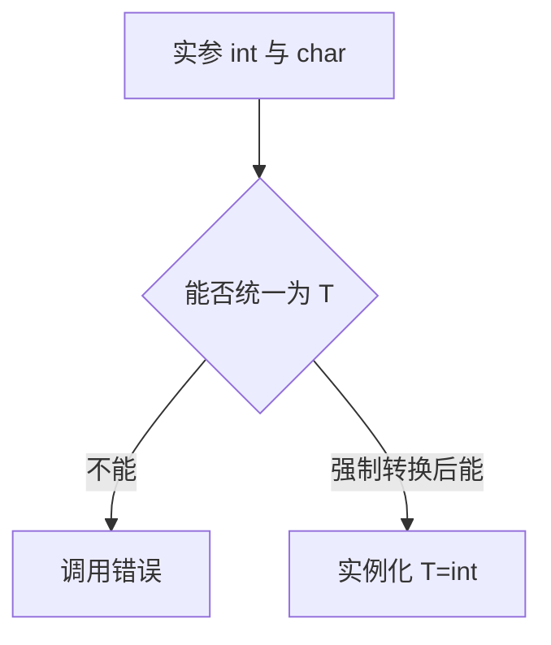

# 重载模板函数

## 它是什么

先想一个问题：函数模板实例化后，所有版本都执行 ==相同的任务==；如果不同类型要执行==不同任务==，还能只用一个模板吗？

在课件里，函数模板

```cpp
template <class T>
T Max(T a, T b){ return (a>b)? a : b; }
```

对 `int`、`double` 都做“用 `<` 或 `>` 比较大小”。但 `char*` 不能用 `>` 比内容，要用 `strcmp`。所以函数名相同、操作不同时，要像重载普通函数那样 ==重载模板函数==：

```cpp
char* Max(char* a, char* b){
    return (strcmp(a,b)>0)? a : b;
}
```

## 为什么需要

模板要求严格：同一模板实例化后的所有模板函数必须执行 ==相同任务==。普通重载允许各函数体做不同事；模板不行。遇到“比较逻辑按类型变化”的情况，就要重载模板函数。

## 怎么做与常见坑

调用时编译器按实参类型选：非模板精确匹配优先，再模板实例化。

看考题里的模板：

```cpp
template <class T>
T min(T x, T y){ return (x<y)? x : y; }
int i,j; char c;
```

调用 `min(i,c)` 时，一个 `int`、一个 `char`，模板要求 `T` 同时是两者，无法统一实例化，因此 ==错误==。而 `min((int)c,i)` 先强制转成 `int`，就能实例化 `T=int`。



| 调用 | 结果 |
|---|---|
| `min(i,i)` | 正确，`T=int` |
| `min(c,c)` | 正确，`T=char` |
| `min((int)c,i)` | 正确，先转 `int` |
| `min(i,c)` | ==错误，类型不统一== |

> [!IMPORTANT]
> 模板参数 `T` 必须从所有实参推出 ==同一类型==，否则调用失败；重载模板函数则用于处理“同名但任务不同”的情形。

## 和相近概念的区别

普通重载：同名函数，参数不同，函数体可不同任务。  
函数模板：一个模板生成多版本，各版本 ==必须相同任务==。  
重载模板函数：在非模板重载无法满足差异任务时，补充同名函数或另一模板。

> [!WARNING]
> 不要以为模板能自动处理 `char*` 内容比较；它只会用运算符，字符串要用重载里的 `strcmp`。
