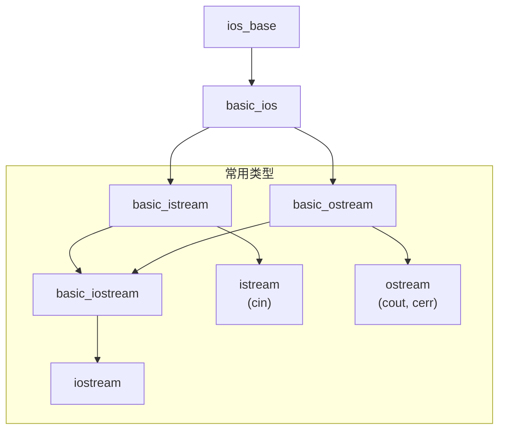

# 键盘输入与屏幕输出（输入/输出类的定义与使用）

键盘输入与屏幕输出是程序与用户交互的“门面”。在C++中，这一切都建立在==**流（Stream）**==的概念上。想象一下，数据就像水流一样，从键盘（输入设备）“流”入程序，再从程序“流”向显示器（输出设备）。C++标准库为我们提供了现成的管道和阀门，让我们无需关心底层硬件细节，就能轻松实现数据的读写。

## C++的流类体系与核心对象

C++的I/O操作并非由语言核心直接定义，而是通过标准库中的==**I/O流类库**==来实现的。这个库是一个精心设计的类层次结构，其中与键盘和屏幕打交道最密切的是几个预定义的全局流对象。

当我们写下 `#include <iostream>` 时，我们就获得了四个标准流对象：

- `cin`：`istream`类的对象，代表==标准输入流==，默认绑定到键盘。
- `cout`：`ostream`类的对象，代表==标准输出流==，默认绑定到显示器。
- `cerr` 和 `clog`：也是`ostream`类的对象，用于输出错误信息。

这些对象背后的类体系，是理解I/O操作的关键。其简化层次结构如下：



> [!NOTE]
> `istream` 和 `ostream` 是 `basic_istream<char>` 和 `basic_ostream<char>` 的类型别名，专为处理 `char` 类型的字符流设计。

## 提取与插入：`>>` 和 `<<`

`cin` 和 `cout` 最常用的操作就是通过==提取运算符 `>>`== 和 ==插入运算符 `<<`== 进行的。

- **输出（插入）**：`cout << 表达式;` 将表达式的值“插入”到输出流中。
- **输入（提取）**：`cin >> 变量;` 从输入流中“提取”数据，并存入变量。

`<<` 和 `>>` 在这里被==重载==了，它们的含义不再是位移，而是流动的方向。可以连续使用，形成链式操作，非常直观：

```cpp
int a, b;
double c;
std::cout << "请输入两个整数和一个浮点数：";
std::cin >> a >> b >> c; // 链式输入
std::cout << "a = " << a << ", b = " << b << ", c = " << c << std::endl; // 链式输出
```

`cin >>` 在读取时，会==默认跳过前导的空白字符==（空格、制表符、换行符），并根据变量的类型解析后续字符，直到遇到下一个空白字符或类型不匹配的字符为止。

## 与C风格I/O的对比

从C语言过来的同学，一定对 `printf` 和 `scanf` 很熟悉。那么，为什么C++要引入 `cin` 和 `cout` 呢？

| 特性 | C++ 流 I/O (`cin`/`cout`) | C 风格 I/O (`scanf`/`printf`) |
| :--- | :--- | :--- |
| **类型安全** | ==安全==。编译器在编译期检查类型，类型不匹配会报错。 | ==不安全==。依赖格式字符串（如`%d`），运行时才解析，类型错误可能导致未定义行为。 |
| **可扩展性** | ==好==。可以==重载==`<<`和`>>`，为自定义的类提供输入输出能力。 | 差。无法直接为自定义类型添加格式说明符。 |
| **使用便捷性** | ==简洁==。无需记忆格式符，`endl`自动换行并刷新缓冲区。 | 繁琐。需要手动指定格式符，且需小心处理换行和缓冲区。 |

> [!IMPORTANT]
> C++流I/O的核心优势在于其==类型安全==和==可扩展性==，这是C风格I/O无法比拟的。在现代C++编程中，应优先使用流I/O。

## 一个算对了的例子：为自定义类重载流运算符

假设我们有一个表示复数的 `Complex` 类，我们希望能像内置类型一样直接使用 `cin` 和 `cout` 来输入和输出它。

```cpp
#include <iostream>

class Complex {
private:
    double real, imag;
public:
    Complex(double r = 0.0, double i = 0.0) : real(r), imag(i) {}

    // 声明友元函数，以便访问私有成员
    friend std::ostream& operator<<(std::ostream& os, const Complex& c);
    friend std::istream& operator>>(std::istream& is, Complex& c);
};

// 重载输出运算符 <<
std::ostream& operator<<(std::ostream& os, const Complex& c) {
    os << "(" << c.real << (c.imag >= 0 ? "+" : "") << c.imag << "i)";
    return os;
}

// 重载输入运算符 >>
std::istream& operator>>(std::istream& is, Complex& c) {
    std::cout << "请输入实部和虚部：";
    is >> c.real >> c.imag;
    return is;
}

int main() {
    Complex c1, c2(3, -4.5);
    std::cout << "c2 = " << c2 << std::endl; // 输出: c2 = (3-4.5i)

    std::cin >> c1; // 调用重载的 >>
    std::cout << "c1 = " << c1 << std::endl; // 输出: c1 = (xx+yyi)
    return 0;
}
```

这个例子完美地展示了C++ I/O流的威力。通过重载`<<`和`>>`，我们让`Complex`类无缝地融入了C++的I/O体系。

> [!WARNING]
> 重载流运算符时，有两个==黄金法则==：
> 1.  必须返回流的==引用==（`ostream&` 或 `istream&`），以支持链式操作。
> 2.  第二个参数（对于`>>`）必须是==非const引用==，因为它要被修改；而第一个参数（对于`<<`）和第二个参数（对于`<<`）通常是`const`引用，以避免不必要的拷贝。它们通常被声明为类的==友元函数==，以便访问私有成员。

> [!TIP]
> 当需要读取一整行包含空格的文本时，`cin >>` 会在第一个空格处停止。此时应使用 `std::getline(cin, str)`，它能读取直到换行符的所有内容。
