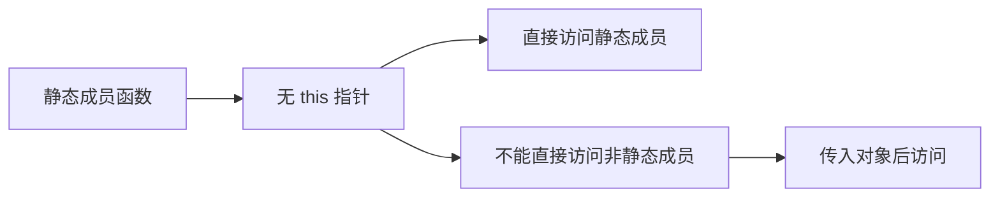

# 静态成员函数的定义与调用限制

## 为什么需要静态成员函数

普通成员函数总是围绕某个对象工作：调用 `obj.show()` 时，编译器会把 `obj` 的地址通过隐含的 `this` 指针传进去，函数才能访问该对象的非静态成员。

但有些操作并不依赖某个具体对象，例如：

- 统计当前一共创建了多少个对象；
- 输出类的共享计数器；
- 在还没有创建对象时，访问类的公有静态数据。

这时就应使用==静态成员函数==：它属于整个类，而不是某个对象。

## 定义与调用

在类内声明时加 `static`，类外定义时不再写 `static`：

```cpp
class Student {
private:
    static int count;       // 静态数据成员
    int score;              // 非静态数据成员
public:
    Student() { ++count; }

    static int getCount();  // 静态成员函数声明
};

int Student::count = 0;     // 类外初始化，不写 static

int Student::getCount() {   // 类外定义，也不写 static
    return count;
}
```

推荐通过类名调用：

```cpp
Student::getCount();  // 不要求已经存在 Student 对象
```

也可以通过对象调用：

```cpp
Student a;
a.getCount();         // 合法，但容易误以为它依赖对象 a
```

> [!IMPORTANT]
> 静态成员函数==没有 `this` 指针==，因此不能直接访问非静态成员，也不能直接调用非静态成员函数。

## 调用限制从哪里来

可以这样想：执行 `Student::getCount()` 时，可能连一个 `Student` 对象都没有。如果允许函数直接写 `return score;`，它该返回哪个对象的成绩呢？

```cpp
static void show() {
    // ++count;       正确：访问静态数据成员
    // cout << score; 错误：不知道访问哪个对象的 score
}
```

若确实需要操作某个对象，可以把对象或对象引用作为参数传入：

```cpp
static void showScore(const Student& s) {
    cout << s.score;  // 在类内定义时，可访问 s 的私有成员
}
```

这里访问的是**参数指定的对象** `s`，仍然不是因为静态成员函数拥有 `this`。



## 与普通成员函数对比

| 对比项 | 静态成员函数 | 普通成员函数 |
|---|---|---|
| 归属 | 整个类 | 类的对象 |
| `this` 指针 | 没有 | 有 |
| 推荐调用方式 | `类名::函数名()` | `对象.函数名()` |
| 直接访问静态成员 | 可以 | 可以 |
| 直接访问非静态成员 | 不可以 | 可以 |
| 是否必须有对象才能调用 | 否 | 是 |

> [!WARNING]
> “没有 `this` 指针”不等于“没有返回值、返回类型或指针参数”。静态成员函数同样可以写成 `static Student* create();`。考试选择题若问“静态成员函数没有什么”，应选 **`this` 指针**。

## 一个算对了的例子

```cpp
#include <iostream>
using namespace std;

class Counter {
private:
    static int n;
public:
    Counter() { ++n; }
    static int get() { return n; }
};

int Counter::n = 0;

int main() {
    cout << Counter::get() << ' ';  // 尚无对象，输出 0
    Counter a, b;
    cout << Counter::get() << ' ';  // 创建两个对象，输出 2
    cout << a.get() << endl;        // 合法，仍输出 2
}
```

输出为：

```text
0 2 2
```

三次调用访问的都是同一个 `Counter::n`，而不是各对象自己的计数器。

> [!TIP]
> 解题先抓两点：静态数据成员要在类外定义初始化；静态成员函数没有 `this`，只能直接处理静态成员。看到“通过对象调用静态函数”不要立即判错，它合法，只是通常不如“类名::函数名”清晰。
