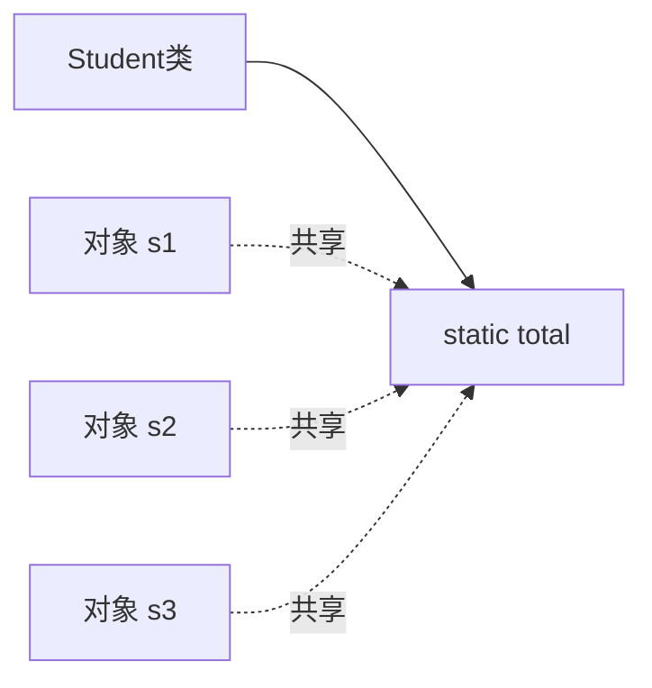

# 静态数据成员的定义与初始化

> [!IMPORTANT]
> 静态数据成员属于类的范畴，为所有同类对象所共享。它不随对象的创建而重复分配空间，整个类只有一份副本。

## 为什么需要它？

假设要统计 `Student` 类一共创建了多少个对象。如果用普通数据成员 `total`，每个对象都会自带一个独立的 `total`，修改一个并不影响其他对象。那么，==如何让所有对象共用同一个计数器？== 答案就是使用静态数据成员。



## 怎么做：声明与初始化

静态数据成员的使用分为两步：**类内声明**，**类外初始化**。

1. **类体内声明**：用 `static` 关键字修饰。
2. **类体外初始化**：必须在类外进行，格式为：
   `<类型> <类名>::<静态数据成员名> = <初始值>;`

若未显式赋初值，系统默认值为 $0$。

```cpp
class Student {
private:
    static int total; // 类内声明（私有）
public:
    Student() { total++; }
    static int getTotal() { return total; } // 通过公有函数间接访问
};

// 类体外语句：用来初始化静态数据成员
int Student::total = 0; 
```

> [!WARNING]
> 静态数据成员的初始化**必须在类外进行**（C++11 前的严格规定，也是本课程考点）。选择题中“可以在类体内进行初始化”是典型的错误选项。

## 访问方式

访问权限决定了调用形式：

- **公有（public）**静态数据成员：可通过 `类名::成员名` 直接调用，也可通过对象名调用。推荐前者，因为即使没有定义任何对象也能访问。
- **私有（private）**静态数据成员：只能通过类的公有成员函数间接访问。

> [!TIP]
> 填空题常考作用域解析运算符的写法。例如：类 `AB` 中有公有静态成员 `static int a;`，在类外不通过对象名将其赋值为 $10$ 的写法是：`AB::a = 10;`。

## 与相近概念的区别

| 特性 | 普通数据成员 | 静态数据成员 | 常数据成员（`const`） |
| :--- | :--- | :--- | :--- |
| **归属** | 属于单个对象 | ==属于类，同类对象共享== | 属于单个对象 |
| **内存分配** | 每个对象各一份 | 全局仅一份 | 每个对象各一份 |
| **初始化位置** | 构造函数体或初始化列表 | ==必须在类体外== | 只能在构造函数初始化列表中 |
| **默认值** | 随机值 | $0$ | 无默认值，必须初始化 |

> [!NOTE]
> 常数据成员提供了一个不变化的量只在类范围内使用。为了避免数据冗余，一般将常数据成员定义为**静态常成员**（`static const`），这样既不可变又全类共享。

## 常见易错坑

> [!CAUTION]
> 1. **忘记类外初始化**：只在类内写了 `static int count;` 却没在类外写 `int ClassName::count = 0;`，链接时会报 `undefined reference` 错误。
> 2. **混淆访问语法**：公有静态成员在对象定义前就能以“类名::公有静态数据成员名”的形式访问，这是正确的描述。
> 3. **误加 `static`**：在类外初始化时，==不能再写 `static` 关键字==，即写成 `static int Student::total = 0;` 是错误的。

## 完整示例

结合课件中的学生类场景，演示正确用法：

```cpp
#include <iostream>
using namespace std;

class Student {
private:
    static int total; // 私有静态数据成员
public:
    Student() { total++; }
    ~Student() { total--; }
    // 私有静态成员需通过公有成员函数间接访问
    static void printTotal() { 
        cout << "当前学生总数: " << total << endl; 
    }
};

// 类体外语句：用来初始化静态数据成员
int Student::total = 0; 

int main() {
    // 尚未定义对象，即可通过类名访问公有静态成员函数
    Student::printTotal(); // 输出: 当前学生总数: 0
    
    Student s1, s2;
    Student::printTotal(); // 输出: 当前学生总数: 2
    return 0;
}
