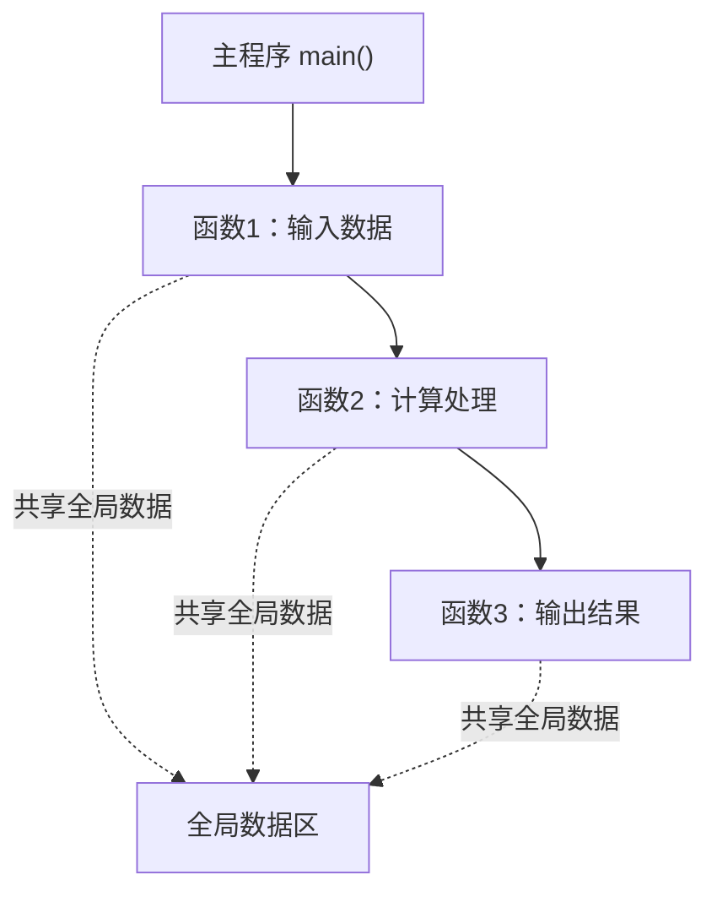

# 面向过程的程序设计与面向对象的程序设计对比

## 面向过程 vs 面向对象：两种程序设计的“世界观”

在动手写 C++ 之前，先想一个问题：**当你要用程序解决一个实际问题时，你首先思考的是什么？** 是“这件事要分几步做完”，还是“这件事里有哪些东西在相互作用”？对这个问题的不同回答，恰好对应了两种程序设计思想。

### 面向过程的程序设计

面向过程（Procedure-Oriented Programming）的核心是 **功能分解**。你把一个问题看作一个大的处理流程，然后自顶向下逐步细化，把大流程拆成一个个函数。数据和操作是分离的——数据是数据，函数是函数，函数接受数据、处理数据、返回结果。



它的优点是直观、容易上手：先做什么、再做什么，逻辑清晰，适合规模较小、流程明确的问题。但当程序变大后，问题会逐渐暴露——==数据和操作数据的函数相互分离==，任何一个函数都可能修改全局数据，导致数据状态难以追踪，程序越来越难维护和扩展。

### 面向对象的程序设计

面向对象（Object-Oriented Programming）换了一个视角：先不急着想“步骤”，而是想 **这个系统里有哪些对象**。对象既包含数据（属性），也包含能对这些数据做什么操作（方法）。对象之间通过消息（调用方法）来协作完成任务。

例如，一个学生成绩管理系统。面向过程的思路是：写“录入成绩”“计算平均分”“打印成绩单”等函数，数据作为参数在函数间传递。面向对象的思路则是：先识别出 `Student` 类——它有属性（姓名、学号、成绩）和方法（计算平均分、打印信息），然后由 `Student` 对象自己来完成这些操作。

### 两种思想的对比

| 对比维度 | 面向过程 | 面向对象 |
| :--- | :--- | :--- |
| **基本单元** | 函数 | 类 / 对象 |
| **核心思路** | 做什么事，分几步做 | 有哪些对象，对象怎么交互 |
| **数据与操作** | 分离（数据通过参数传递） | 封装在对象内部 |
| **程序结构** | 函数调用链 | 对象之间的消息传递 |
| **适用规模** | 中小规模、流程式问题 | 中大规模、复杂系统 |
| **可维护性与可扩展性** | 相对较弱 | 较强 |

> [!IMPORTANT]
> 面向对象有四大特征：**抽象、封装、继承、多态**。考试中常以填空形式出现，其中“抽象”有时被省略，只问另外三个，但完整说法是四个。

### C++ 的双重身份

C++ 语言的独特之处在于：它由 C 语言发展而来，**兼容 C 的语法，同时支持面向过程和面向对象两种风格**。对于面向过程编程，C++ 与 C 的关系可以用两个词概括——==继承和改进==。也就是说，你可以几乎原样使用 C 风格的面向过程写法，也可以使用 C++ 改进后的更方便的写法（比如 `bool` 类型、引用类型、函数重载等，第 2 章会详细介绍）。

> [!TIP]
> 考试中见到“C++ 与 C 语言在面向过程方面的关系”这类题，答案关键词就是 **“继承和改进”**。另外，`main()` 函数是 C++ 程序的入口，无论哪种风格的程序都从这里开始执行。

### 常见的坑

初学者最容易踩的坑是 **“用面向对象的语法写面向过程的程序”**。比如定义了一个类，但把所有数据都设为 `public`，然后在 `main()` 里写一堆函数直接操作这些数据——这本质还是面向过程思维，只是把函数搬进了类里。真正的面向对象要求 **数据封装在类内，外部只能通过类的公有方法访问**。

> [!CAUTION]
> 不要从字面理解“面向对象”就是“面对着一个对象”。“对象”在这里是程序中的基本实体，不是“目标”“对象”的日常含义。

### 一个判断题帮你自测

下面这段 C++ 代码属于哪种风格？为什么？

```cpp
// 风格A：面向过程
double area(double r) {
    return 3.14159 * r * r;
}

// 风格B：面向对象
class Circle {
private:
    double radius;
public:
    Circle(double r) : radius(r) {}
    double area() { return 3.14159 * radius * radius; }
};
```

风格 A 中，`area` 是一个独立函数，数据 `r` 从外部传入；风格 B 中，`radius` 是 `Circle` 对象自己的数据，`area()` 是对象自己的行为。==判断的关键在于数据和对数据的操作是否被组织在一起==。
