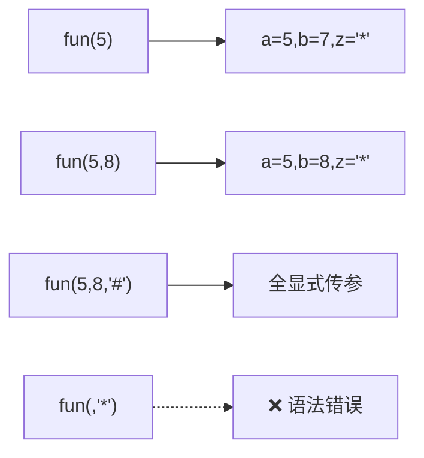

# 形式参数可带有默认值

## 什么是默认参数

在 C++ 中，允许在函数声明时为==形式参数指定默认值==。当调用该函数时，若未传递对应的实参，编译器将自动使用预设的默认值；若传递了实参，则默认值被覆盖。这一机制属于“C++ 对 C 语言的改进及扩展”，旨在简化函数调用接口，避免为同一功能编写多个重载版本。

> [!IMPORTANT]
> 默认参数是**编译期绑定**的语法糖，不是运行时动态判断。调用 `f(10)` 等价于在源码层面直接替换为 `f(10, "example")`。

## 为什么需要默认参数

设想一个打印日志的函数，大多数情况下级别为 `INFO`、输出到控制台。若无默认参数，要么每次手写完整参数，要么额外定义 `printLog(string msg)` 重载。默认参数将“常用配置”内嵌于签名中，既减少代码冗余，又保持单一入口。

## 语法规则与正确示例

默认参数的设置必须遵循==从右向左连续==的原则：一旦某个参数设有默认值，其右侧所有参数都必须有默认值。

| 声明 | 合法性 | 原因 |
| :--- | :--- | :--- |
| `int fun(int a=1, int b=2, int c=3);` | ✅ | 全部带默认值，连续 |
| `int fun(int a, int b=2, int c=3);` | ✅ | 从 b 开始向右连续 |
| `int fun(int a, int b=2, int c);` | ❌ | b 有默认值但 c 没有，断裂 |
| `int fun(int a=1, int b, int c=3);` | ❌ | a 有默认值但 b 没有，断裂 |

以真题为例，原型 `void fun(int a, int b=7, char z='*');` 的合法调用包括 `fun(5)`、`fun(5,8)`、`fun(5,8,'#')`，但 `fun(,"*")` 非法——==不能跳过中间参数只传后面的实参==。

## 默认参数与函数重载的二义性

这是考试高频陷阱。当存在 `void f(int x);` 和 `void f(int x, char *s="example");` 两个重载时，调用 `f(10)` 会产生==二义性==：第一个版本精确匹配，第二个版本通过默认参数也能匹配，编译器无法抉择。

> [!WARNING]
> ==默认参数不参与重载决议的唯一性保证==。若去掉默认值后两个函数签名相同或可隐式转换至相同签名，则带默认值的重载极易引发歧义。设计时应确保：任一调用方式只能唯一对应一个候选函数。

## 常见误区辨析

- **构造函数可用默认参数**：正确。构造函数可设缺省参数以实现灵活初始化，但==不能指定返回类型==（连 `void` 也不行），也不能声明为虚函数。
- **成员函数可设默认参数**：正确。但默认值通常在类内声明处指定，定义处不再重复写默认值。
- **默认参数 ≠ 可选参数**：C++ 没有真正的“可选参数”语法，只是通过默认值模拟；调用时仍须按位置传参，不可命名传参或跳参。

> [!TIP]
> 记忆口诀：**默认从右连成线，跳参调用必报错；重载遇上默认值，二义风险要规避。**
