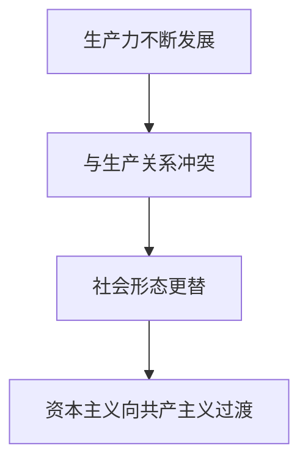

# 共产主义理想实现的必然性与长期性

## 为什么“必然”与“长期”会同时成立

很多同学第一次看到“共产主义理想实现的必然性与长期性”会觉得矛盾：既然必然实现，为什么还要等很久？

先分开看两个词：**必然性**回答的是“方向对不对”，**长期性**回答的是“路有多远”。方向对了，不等于路短。这就像你已经确定考试必过，但从现在到出分之间仍然隔着复习、考试、阅卷的过程——中间的过程一个都不能省。

> [!IMPORTANT]
> ==必然性由社会基本矛盾运动决定，长期性由共产主义社会所要求的历史条件的积累难度决定。== 两者不矛盾，前者是规律判断，后者是过程判断。

---

## 必然性来自哪里

马克思主义不靠“善良愿望”来论证共产主义必然实现，而是从生产方式的内在矛盾出发：

- 生产力是社会发展的最终决定力量。
- 资本主义生产方式包含着自身无法根本解决的基本矛盾：生产社会化与生产资料私人占有之间的矛盾。
- 这一矛盾只能通过建立以公有制为基础的社会关系来解决，方向指向共产主义。
- 马克思主义的科学性在于，它不是空想，而是从现实运动的规律中得出结论。

> [!TIP]
> 记忆抓手：**“生产力—生产关系矛盾 → 资本主义内在矛盾 → 共产主义方向”**，这是整条必然性论证的主线。

---

## 长期性为什么不可跳过

经济文化相对落后的国家可以先进入社会主义，但**建设社会主义、走向共产主义**是一个更长的历史过程。课堂上那句话——经济文化相对落后国家建设社会主义的“必然性和长期性”——正是这一知识点的现实来源。

长期性的根源可以从四个方面把握：

| 方面 | 为什么需要长期过程 |
|------|------------------|
| 生产力 | 物质财富的极大丰富需要数百年积累 |
| 生产关系 | 公有制实现形式需要在实践中反复探索 |
| 上层建筑 | 人的思想觉悟、社会管理制度需要逐步发展 |
| 国际环境 | 社会主义将长期与资本主义共处、竞争 |

> [!WARNING]
> 常见错误：把“长期性”理解为“遥遥无期所以不用努力”。长期性恰恰要求一代代人接续奋斗，而不是坐等历史自行完成。

---

## 和“空想社会主义”的区别

容易混淆的是：既然共产主义一定来，那空想社会主义者不也说理想社会会来吗？区别在于**论证方式**：

- 空想社会主义：靠天才头脑设计未来，靠启发人们的善良天性来实现。
- 科学社会主义：从现实的经济关系和阶级运动中揭示趋势，不预设静止的“完美蓝图”。

所以，共产主义理想的必然性不是愿望的必然，而是==规律运动的必然==。

---

## 一个“算对了”的理解框架

用题目里常出现的那句话来验证：马克思主义最崇高的社会理想是“物质财富极大丰富、人民精神境界极大提高、每个人自由而全面发展”的共产主义社会。

把必然性与长期性放到一起，可以得到一个清晰的判断链条：

1. 生产力发展 → 必然推动社会形态向前演进；
2. 但“极大丰富”“极大提高”“自由而全面发展”不是一夜之间出现的；
3. 所以从资本主义到共产主义必须经过社会主义这一过渡性历史阶段；
4. 社会主义本身也要在长期实践中完善。

> [!NOTE]
> 考试中如果问“如何理解共产主义实现的必然性和长期性”，落点通常不是背语录，而是用社会基本矛盾原理说明**为什么必然**，再用历史条件的复杂性说明**为什么长期**，最后落到“坚定理想与脚踏实地相统一”。

---

## 与“共同理想”不冲突

共产主义远大理想与中国特色社会主义共同理想是**阶段与目标**的关系。共同理想是走向远大理想的现实步骤，远大理想为共同理想提供方向。否定任何一个都会走偏：

- 只讲远大理想、不讲现实步骤 → 空谈。
- 只讲当下目标、忘记远大方向 → 短视。

> [!CAUTION]
> 不要写“共产主义一经革命胜利就自动实现”。经典马克思主义认为，共产主义只能在物质和精神条件高度成熟的基础上实现，任何用行政命令“跑步进入”的做法都违背历史唯物主义。
