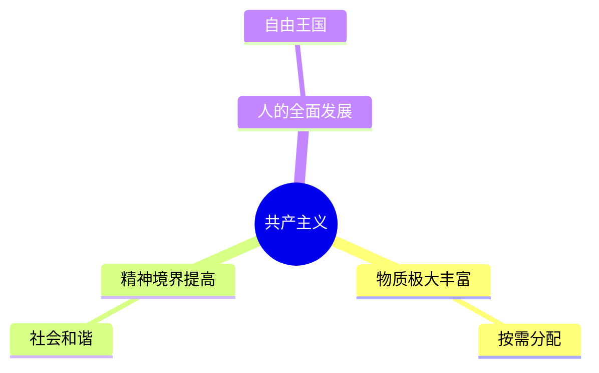

# 共产主义社会的基本特征（物质财富极大丰富、精神境界极大提高、每个人自由而全面发展）

> [!IMPORTANT]
> 共产主义社会的基本特征是马克思主义最崇高的社会理想，也是理解“马克思主义是科学性与革命性的统一”的落脚点。

## 它是什么

如果资本主义必然被社会主义代替，那么人类最终走向哪里？答案就是共产主义社会。根据教材第 259-264 页内容，其基本特征包含三个维度：

1. **物质财富极大丰富**，消费资料“按需分配”。
2. **社会关系高度和谐**，人们精神境界极大提高。
3. ==每个人自由而全面的发展==，人类从必然王国向自由王国飞跃。

这三个特征不是孤立的，而是层层递进的关系：物质基础决定上层建筑，进而为人的解放提供条件。

## 为什么需要掌握它

在南邮《马克思主义基本原理》考试中，这个知识点常作为简答题的核心得分点出现。例如真题：“如何理解马克思主义是科学性与革命性的统一？”其标准答案的第（4）点正是：

> 实现物质财富极大丰富、人民精神境界极大提高、每个人自由而全面发展的共产主义社会，这是马克思主义最崇高的社会理想。

如果不熟悉这三大特征的准确表述，这道简答题就会直接丢掉一个关键采分点。

## 怎么做：精准记忆与答题

背诵时切忌死记硬背，可以按照“物—心—人”的逻辑链条来推导：

- **物**：生产力高度发达 $\rightarrow$ 物质财富极大丰富 $\rightarrow$ 分配方式变为“按需分配”。
- **心**：物质满足后 $\rightarrow$ 阶级消灭、国家消亡 $\rightarrow$ 社会关系高度和谐、精神境界极大提高。
- **人**：摆脱了物质匮乏与社会压迫 $\rightarrow$ ==每个人自由而全面的发展== $\rightarrow$ 实现从必然王国向自由王国的飞跃。

> [!TIP]
> 答题口诀：“物丰按需分，和谐境界高，自由全发展，必然到自由。”

## 和相近概念的区别

很多同学容易把“按需分配”和日常语境中的“平均主义”搞混，或者把“自由发展”等同于“随心所欲”。

| 比较维度 | 共产主义社会的特征 | 常见误解 / 其他社会形态 |
| :--- | :--- | :--- |
| **分配方式** | 按需分配（基于物质极大丰富） | 平均主义（无视个体差异的绝对均等） |
| **人的状态** | 自由而全面的发展（摆脱异化） | 随心所欲（缺乏社会规律的约束） |
| **社会阶段** | 人类最终理想（科学预测） | 乌托邦（脱离客观规律的空想） |

> [!WARNING]
> 答名词解释“马克思主义”时，目标是“反对资本主义、建设社会主义和实现共产主义”，不要漏掉“实现共产主义”这一最终指向；答简答“科学性与革命性统一”时，必须完整写出三大特征，缺一不可。

## 常见的坑

> [!CAUTION]
> 极易混淆“按劳分配”与“按需分配”！社会主义社会实行的是“按劳分配”，只有到了共产主义社会，物质财富极大丰富了，才能实行“按需分配”。写错这两个词，整句话直接判零分。

此外，第三个特征中“必然王国向自由王国飞跃”是固定搭配，不能写成“自由王国向必然王国飞跃”，方向反了意味着历史倒退。

## 算对了的例子

**【历年真题节选】简答：如何理解马克思主义是科学性与革命性的统一？**

**正确作答示范（节选相关部分）：**
……
（4）实现物质财富极大丰富、人民精神境界极大提高、每个人自由而全面发展的共产主义社会，这是马克思主义最崇高的社会理想。

> [!NOTE]
> 阅卷老师找的就是“物质财富极大丰富”“精神境界极大提高”“每个人自由而全面发展”这三个短语。只要踩准这三个关键词，该得分点即可拿满。学习本章绪论时，务必将其与“预见未来社会的科学方法论原则”结合起来，深刻认识实现共产主义的历史必然性和长期性。
