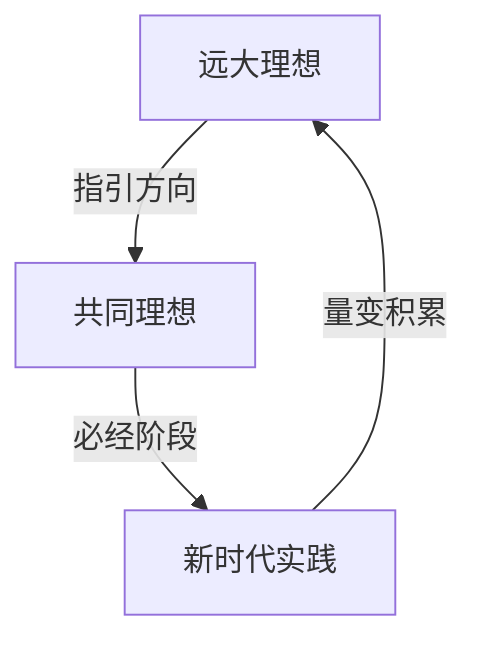

# 共产主义远大理想与中国特色社会主义共同理想的统一

> [!IMPORTANT]
> 共产主义远大理想与中国特色社会主义共同理想是==辩证统一==的关系，二者相互联系、不可分割。

## 它是什么

马克思主义最崇高的社会理想是实现物质财富极大丰富、人民精神境界极大提高、每个人自由而全面发展的共产主义社会。但在走向这一崇高理想的漫长历史进程中，我们必须立足当前实际。

- **共产主义远大理想**：人类社会发展的最终目标，体现人类社会发展规律（矛盾的普遍性）。
- **中国特色社会主义共同理想**：现阶段把我国建设成为富强民主文明和谐美丽的社会主义现代化强国，实现中华民族伟大复兴的中国梦（矛盾的特殊性）。

先思考一个问题：既然共产主义是必然趋势，我们为什么不能直接跨越阶段去实现它？这就引出了把握两者关系的必要性。

## 为什么需要

深刻认识实现共产主义的==历史必然性和长期性==，是我们坚定理想信念的前提。如果只谈远大理想而不顾现实，就会陷入空想；如果只顾眼前而忘记方向，就会迷失道路。结合矛盾普遍性与特殊性辩证关系原理，“社会主义”体现了社会发展的普遍规律和共同本质，“中国特色”则体现了中国基本国情和特殊规律。坚持二者的统一，正是我们在多元文化格局下坚持社会主义主流文化、在初级阶段推进现代化建设的理论根据。

## 怎么做

在实践中把握两者的辩证关系，需遵循预见未来社会的科学方法论原则：

1. **以远大理想指引方向**：坚持以马克思主义为指导思想，用马克思主义理论武装头脑。
2. **以共同理想凝聚力量**：从我国仍处于社会主义初级阶段的最大实际出发，在遵循社会主义建设规律的基础上发挥主观能动性。
3. **投身具体实践**：将宏大的中国梦与具体的个人梦结合起来，积极投身新时代中国特色社会主义事业，不断增强服务社会的本领。

## 与相近概念的区别

| 比较维度 | 共产主义远大理想 | 中国特色社会主义共同理想 |
| :--- | :--- | :--- |
| **时间跨度** | 最终目标，极其漫长的历史过程 | 现阶段的具体奋斗目标 |
| **哲学属性** | 矛盾的普遍性（共性） | 矛盾的特殊性（个性） |
| **核心内涵** | 每个人自由而全面发展 | 国家富强、民族振兴、人民幸福 |
| **相互关系** | 共同理想的最终指向和精神支柱 | 实现远大理想的必经阶段和现实基础 |

> [!NOTE]
> 共性寓于个性之中，没有离开个性的共性，也没有离开共性的个性。远大理想必须通过共同理想的阶段性实践来逐步实现。

## 常见的坑

> [!WARNING]
> 答题时切忌将二者割裂或对立。常见错误包括：认为“讲共同理想就是放弃远大理想”，或者“讲远大理想就可以脱离现阶段国情”。

> [!CAUTION]
> 论述题中若要求“结合现实问题”，务必落脚到“我国正处于全面建设社会主义现代化国家的关键时期”这一最大实际，强调尊重客观规律与发挥主观能动性的统一。

## 经典例题示范

**题目**：试结合当前的现实问题，谈谈我们为什么要坚持以马克思主义为指导？

**解析思路**：这道题表面上问“为什么坚持指导”，实际上考查的就是如何用马克思主义（包含其最高理想）来统领当前的共同理想与实践。

**标准作答要点**：
（1）**理论根基**：马克思主义是科学的世界观和方法论，基本特征是科学性与革命性的统一，这是历史和人民的自觉选择。
（2）**立足实际**：我国仍处于社会主义初级阶段，需要马克思主义指导社会主义建设，实现共同理想。
（3）**应对挑战**：在世界文化多元化格局下，需以马克思主义武装头脑，坚持社会主义主流文化。
（4）**坚定信念**：在全面建设社会主义现代化的关键时期，需要以马克思主义坚定==理想信念==，为共同理想奋斗。
（5）**青年担当**：青少年实现中国梦、增强服务社会本领，离不开马克思主义的指导。

> [!TIP]
> 记忆口诀：“理实文信青”——**理**论根基、**实**际国情、**文**化多元、**信**念坚定、**青**年追梦。答此类简答/论述题时，按这五个层次展开即可拿满要点分。
