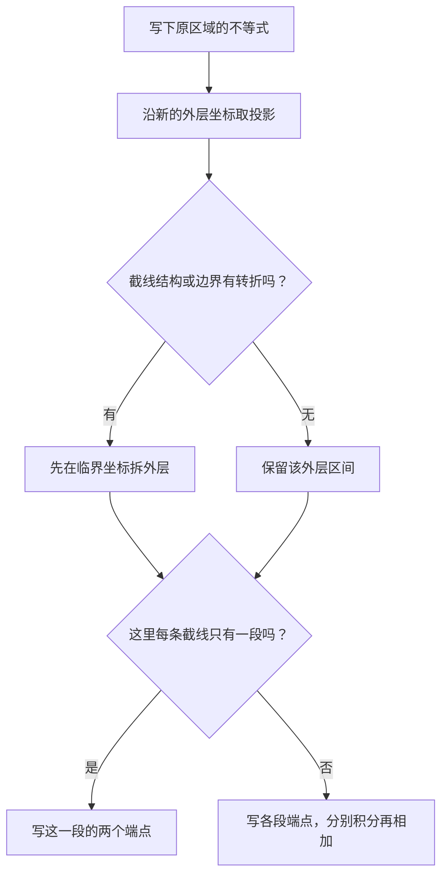

# 二重积分：区域与换序

二重积分把一个平面区域里每一点的贡献加起来。迭代积分是其中一种记账方法：先扫完一条截线，再扫过所有截线。换序时改变的是扫法，不是区域，也不是被积函数。

若原式是先对 $x$ 积分，内层上下限告诉你：选定一个固定的 $y$ 后，这一条水平线从哪儿进入区域、从哪儿离开。想改成先对 $y$ 积分，就问：固定 $x$ 后，哪一段竖线还留在原来的区域里？先写二元不等式，再取新的外层投影，最后写每条截线的内部边界。只把 $\mathrm dx$ 和 $\mathrm dy$ 对调，不能假定原上下限仍适用；要按新的截线重写并检查。长方形是内外边界各自为常数的最简单情形。

顺着 ==先投影，再看每条截线== 的步骤，区分两种需要拆开的情况：边界换公式要拆外层区间，截线真有空隙就要把内层分成几段。

例如区域在第一象限、抛物线 $y=4-x^2$ 下方。同一片区域可以写成：

$$
0\le y\le4,\quad 0\le x\le\sqrt{4-y}
\qquad\Longleftrightarrow\qquad
0\le x\le2,\quad 0\le y\le4-x^2.
$$

左式沿水平方向切，右式沿竖直方向切。边界检查：$x=0$ 时竖截线长为 $4$，$x=2$ 时缩成一点。再用 $f=1$ 检查面积，$\int_0^4\sqrt{4-y}\,\mathrm dy$ 与 $\int_0^2(4-x^2)\,\mathrm dx$ 都得到 $16/3$。面积相同是校验之一，不是区域相同的证明；不同区域可以碰巧有相同面积。

如果同一条截线有两段，是否还能写「从最下到最上」？不能。以环域 $1\le x^2+y^2\le4$ 为例，$x=0$ 的竖截线是 $[-2,-1]\cup[1,2]$。

> [!CAUTION]
> 若把这条截线写成 $[-2,2]$，就把正中间的孔也积分进去了。投影里的坐标值只表示「有点在区域内」，不保证这条线上的两端之间全在区域内。

在有界 Jordan 区域的闭包上被积函数连续，是足够使用换序的常见条件；对奇异或无界的情形，先核适用条件，例如绝对可积，而不能因形式上两套边界都能写就默认相等。实际看见根式、抛物线或非长方形区域，先核平方或开方所在的符号域、两轴投影和临界截线，再决定换序后是否真的更易计算。
