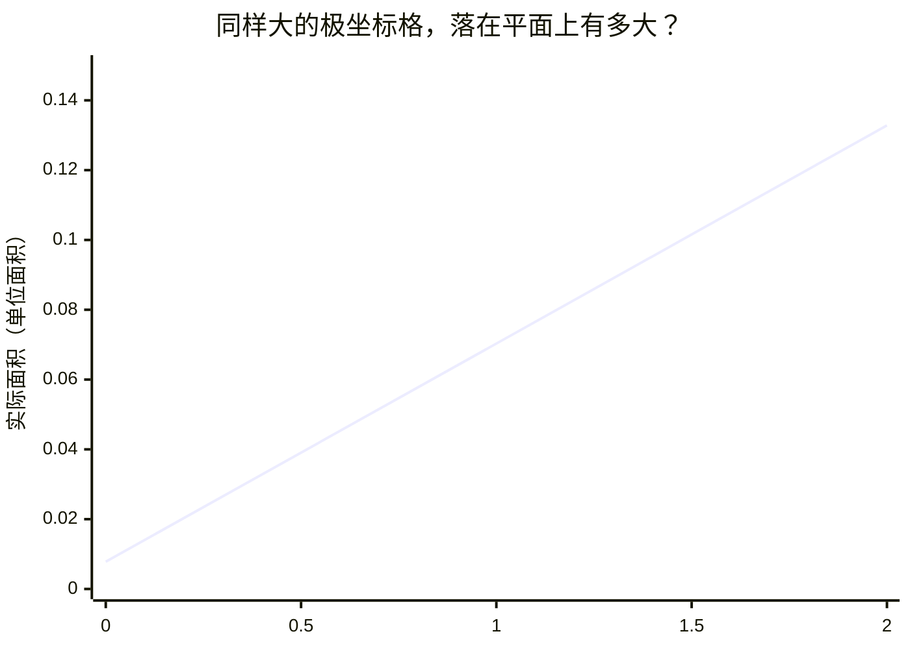

# 二重积分的极坐标换元

在圆盘里，离圆心同样远的点，常常对积分贡献相同。用 $(x,y)$ 扫描，不断碰到根式边界；改用到原点的距离 $r$ 和方向 $\theta$，同心圆就变成 $r$ 为常数的边界。但如果把方格纸上 $\mathrm dx\,\mathrm dy$ 直接写成 $\mathrm dr\,\mathrm d\theta$，已经把每块面积算错了：向外走，==同一个角度扫过的弧会越来越长==。

$$
x=r\cos\theta,\qquad y=r\sin\theta,\qquad r\ge0.
$$

半径从 $r$ 到 $r+\Delta r$、角度宽 $\Delta\theta$ 的小环扇，面积为

$$
\frac12[(r+\Delta r)^2-r^2]\Delta\theta
=r\,\Delta r\,\Delta\theta+\frac12(\Delta r)^2\Delta\theta.
$$

一阶面积因子就是 $r$。把径宽固定在 $1/4$、角宽固定在 $1/4$ 弧度，比较从不同半径起步的小环扇：每次向外平移半个单位，面积就多 $1/32$。横轴是扇形内侧的半径；原点附近也有小块面积，只是此时一阶项为零，整个面积由二阶项给出。

从坐标变换核对也一样：

$$
\det\begin{pmatrix}\cos\theta&-r\sin\theta\\\sin\theta&r\cos\theta\end{pmatrix}=r .
$$

于是对被所选极坐标参数区域覆盖一次的平面区域 $D$，若 $f$ 连续，换元后用 $f(r\cos\theta,r\sin\theta)\,r\,\mathrm dr\,\mathrm d\theta$，并在新坐标里重写区域。$r=0$ 的角度不唯一，但原点是面积为零的单点，不妨碍通常的面积积分。真正需要防的是角度范围让一片正面积区域被重复计数。

例如在第一象限的环带 $1\le x^2+y^2\le4$ 上求 $\iint_D(x^2+y^2)\,\mathrm dA$。看到**圆形边界和平方和同时出现**，就有两个理由换极坐标：固定角度只扫 $1\le r\le2$，函数也变成 $r^2$。角度从 $0$ 到 $\pi/2$，所以

$$
\int_0^{\pi/2}\!\int_1^2 r^2\,r\,\mathrm dr\,\mathrm d\theta=\frac{15\pi}{8}.
$$

> [!TIP]
> 核对有没有漏掉 $r$ 时，先把被积函数换成 $1$。本例应还原四分之一圆环的面积 $3\pi/4$，而不是半径宽度乘角宽 $\pi/2$。区域和边界都不动，只改函数，就能先单独校验面积测度。

圆不以原点为中心时，上限往往跟角度有关。圆盘 $(x-1)^2+y^2\le1$ 化为 $r^2\le2r\cos\theta$，对 $r>0$ 来说，只允许 $-\pi/2\le\theta\le\pi/2$ 且 $r\le2\cos\theta$。其面积为 $2\int_{-\pi/2}^{\pi/2}\cos^2\theta\,\mathrm d\theta=\pi$，与半径 $1$ 的圆面积一致。如果照旧取满一圈，就会遇到负的径向上限；这不是积分值「应取绝对值」的信号，而是选错了参数区域。看到圆弧先画出从原点发出的射线：有的射线根本不碰区域，有的射线上会有多段，不能一律从 $0$ 积到外边界。
