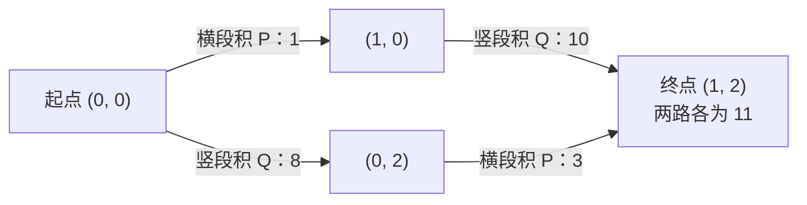

# 势函数与曲线积分的路径无关

从起点走到终点，可以先往东再往北，也可以倒过来。如果每一小段累计的是「高度变了多少」，两条路经过的坡不同，最后的净变化却完全相同。能不能把曲线积分里的 $P\,\mathrm dx+Q\,\mathrm dy$ 也看成某个量的一小步变化？关键不是路线是否笔直，而是能否找到一个量 $U$，使 $U_x=P$、$U_y=Q$。这样的 $U$ 就是场的势函数，这里采用 $\nabla U=(P,Q)$ 的符号约定。

沿任意一条从 $A$ 到 $B$ 的分段光滑曲线 $C$，链式法则给出

$$
\frac{\mathrm d}{\mathrm dt}U(x(t),y(t))=P(x(t),y(t))x'(t)+Q(x(t),y(t))y'(t).
$$

沿全程积分，中途各小段的净变化首尾相接，得到

$$
\int_C P\,\mathrm dx+Q\,\mathrm dy=U(B)-U(A).
$$

也可以反过来想：若任意同起终点的两条路所得都相同，把一条路正走、另一条倒走，就是闭路积分为零；反之，只要所有闭路积分为零，两条同起终点的路线就必相等。在连通的开区域，对连续场固定一个基点，把「从基点积到当前点」记作 $U$，路径无关就保证这个定义不含歧义。再把终点沿一个坐标方向挪一小步，从那条短线段取差商，得到 $U_x=P$ 或 $U_y=Q$。

## 只算出了交叉偏导相等，够吗？

若 $P,Q$ 连续可微，有势函数就必有 $P_y=Q_x$，因为 $U$ 的两个混合偏导相等。反过来，要用 ==交叉偏导相等推出全区路径无关==，常用的保证是场连续可微，且区域是单连通的：任一闭路都能在区域内连续缩成一点。对于能围成一个不出区域的简单闭路，格林公式说明闭路积分为区域内 $Q_x-P_y$ 的积分，恰好为零。若只需要算一条积分，能在整个相关区域直接核对一个势函数，则不必再借助单连通这个充分条件。

> [!CAUTION]
> 「交叉偏导相等」是局部检查，不能自动补上区域里的洞。例如场 $(-y,x)/(x^2+y^2)$ 在去掉原点的平面上满足 $P_y=Q_x$，但逆时针绕原点一周的环流可以是 $2\pi$；围出的圆盘不是场的定义域，不能直接套用格林公式。

## 同一终点，怎么用两条路核对？

在全平面上取 $P=2xy+2x$、$Q=x^2+3y^2$，求从 $A=(0,0)$ 到 $B=(1,2)$ 的任意曲线积分。看到题目不指定路线，先算 $P_y=Q_x=2x$；全平面没有洞，有理由找势函数。

对 $x$ 积分时把 $y$ 固定，得到 $U=x^2y+x^2+h(y)$。不定积分留下的不是常数，而是任何对 $x$ 求导为零的函数。再用 $U_y=Q$ 得 $h'(y)=3y^2$，可取 $h(y)=y^3$。于是

$$
U(1,2)-U(0,0)=2+1+8=11.
$$

下图两条折线给出同一个结果。横段固定 $y$，只积 $P\,\mathrm dx$；竖段固定 $x$，只积 $Q\,\mathrm dy$。两条路线的每段贡献并不相同，只有加完才一致。

两条路线算出同一个数，是有用的算术校验，但不是证明「所有路线都一样」；本题能做到这一步，是因为 $U_x=P$ 和 $U_y=Q$ 在全平面都成立。反过来，只要找到两条同起终点的路积分不等，就足以否定全区路径无关。
