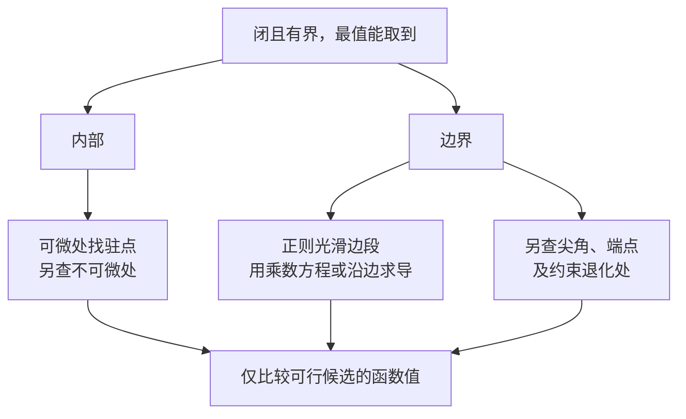

# 多元函数的极值与约束最值

在一张山地图上找最低处，第一件事不是求导，而是看你准往哪里走。在区域内部，可以朝任何方向迈一小步；在边界，只能朝允许的方向走。因此，「各方向的一阶变化都是零」是内部可微极值的必要条件，却不是边界最值的必要条件。

## 驻点附近，曲面是碗还是鞍？

若 $f$ 在内点可微，且有局部极值，则 $\nabla f=0$。梯度为零只排除了一阶变化，接下来要看二阶项。设 $f$ 二阶连续可微，在驻点记

$$
D=f_{xx}f_{yy}-f_{xy}^2.
$$

二阶项是关于位移的二次型：$D>0$ 且 $f_{xx}>0$ 时，各非零方向的二阶变化都为正，是严格极小值；$D>0$ 且 $f_{xx}<0$ 时是严格极大值；$D<0$ 时不同方向的二阶变化有正有负，是鞍点。这些结论来自二阶泰勒展开，二阶误差余项必须比二次项小。$D=0$ 则说明二阶项没有给出足够信息，不能据此判定。

例如 $f_1=x^4+y^2$ 与 $f_2=y^2-x^4$ 在原点的 Hessian 矩阵相同，都是 $\operatorname{diag}(0,2)$。前者在原点严格极小；后者沿 $x$ 轴变小、沿 $y$ 轴变大。这一对例子提醒我们：一旦二次项出现平坦方向，就去看那个方向上被二阶近似略掉了什么，而不是把 $D=0$ 当成「没有极值」。

## 约束住一片区域后，还去哪找候选？

闭且有界的区域上，若 $f$ 连续，最大值和最小值都能取到。要把内部驻点和边界候选==统一比较候选处的函数值==。在光滑边界 $g(x,y)=0$ 上，如果 $\nabla g\ne0$，沿可行切线移动既保持 $g$ 不变，在边界极值点也不会带来 $f$ 的一阶变化。两者梯度都与切线正交，因而有

$$
\nabla f=\lambda\nabla g,\qquad g(x,y)=0.
$$

这就是拉格朗日乘数法为何成立；它寻找的是候选，不会仅凭 $\lambda$ 的正负告诉你谁大谁小。边界有尖角、端点或 $\nabla g=0$ 时，要另外检查，不能因为没有解出乘数就把该处漏掉。

候选要按能否自由移动来分，不是按「哪个方程最好解」来分。下面的路线假定 $f$ 在区域上连续，且已确认区域闭、有界；哪里不满足可微或光滑条件，就把那里单独列入检查。

例如在单位闭圆盘 $x^2+y^2\le1$ 上求 $f=(x-2)^2+2y^2$ 的全局最值。看到「闭圆盘」先拆内部与边界：唯一的无约束驻点 $(2,0)$ 在盘外，不能算。边界用约束 $g=x^2+y^2-1=0$，得到

$$
2(x-2)=2\lambda x,\qquad 4y=2\lambda y.
$$

若 $y\ne0$ 则 $\lambda=2$，代回去会得到 $x=-2$，不在圆上。故候选只余 $(1,0),(-1,0)$；代值得最小值 $1$、最大值 $9$。

> [!TIP]
> 本例两个最值点的梯度都不为零。这不违反内点极值的规则：先看点在不在内部，再问允许沿哪些方向移动。

换一种推理校验，在圆上直接消掉 $y^2$，有 $f=6-x^2-4x=10-(x+2)^2$，它在 $[-1,1]$ 单调下降，给出同样的两点。若边界容易参数化或能立刻消元，先降维也许更短；若边界难以显式解出，乘数方程不要求预先选分支。两种方法都不能省掉最终的候选比较。
