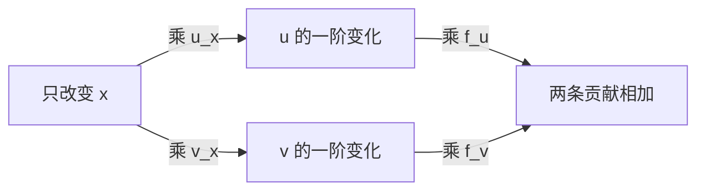

# 多元复合函数的链式法则

给定 $z=f(u,v)$，而 $u=u(x,y)$、$v=v(x,y)$。题目即使没有给 $f$ 的显式表达式，也能求 $z_x$。因为 $x$ 的一个小扰动会分别改变 $u,v$，外层函数只需要这两个一阶变化；同一输入经过两条路径传到输出，结果相加。

若内外层在相应点可微，内层的一阶变化是

$$
\begin{pmatrix}\mathrm du\\\mathrm dv\end{pmatrix}
=
\begin{pmatrix}u_x&u_y\\v_x&v_y\end{pmatrix}
\begin{pmatrix}\mathrm dx\\\mathrm dy\end{pmatrix}.
$$

把它代进 $\mathrm dz=f_u\,\mathrm du+f_v\,\mathrm dv$，跟着 $\mathrm dx$ 或 $\mathrm dy$ 收集系数，得到

$$
z_x=f_u u_x+f_v v_x,\qquad z_y=f_u u_y+f_v v_y.
$$

图里沿一条路要连乘，两条路到同一输出才相加。若改求 $z_y$，外侧两条边仍由 $f_u,f_v$ 决定，只换从输入出发的两条边。

再求一次导数时，哪部分还能当常数？$f_u$ 本身沿着 $u,v$ 变，乘在它外面的 $u_x$ 也可能变。若内外层二阶偏导连续，展开 $(z_x)_y$ 可分为两类：

$$
\begin{aligned}
(z_x)_y={}&
f_{uu}u_xu_y+f_{uv}(u_xv_y+v_xu_y)+f_{vv}v_xv_y\\
&+f_u u_{xy}+f_v v_{xy}.
\end{aligned}
$$

第一行是 $f$ 斜率随输入变，第二行是两条路径自身的灵敏度变。内层是仿射映射时第二行消失，外层若是线性的则第一行消失，这是两种不同的简化。即使混合偏导相等，也不会自动抵消；仍须计算 $f_{uv}(u_xv_y+v_xu_y)$。

以 $z=f(x^2+y,xy)$、$f(u,v)=u$ 为例，外层是线性的且 $u_{xy}=0$，所以 $(z_x)_y=0$。把外层换成 $f(u,v)=v$，第一行仍然全零，结果却是 $1$，因为 $v_{xy}=1$。直接写成 $z=xy$ 也有 $z_x=y$、$(z_x)_y=1$。若把外系数误当常量，这个最简单的特例就算错了。

> [!TIP]
> 外层只给函数名，或题目另外定义了中间量，就先画依赖。第一次求导是 ==同一路径相乘、不同路径相加==；再求一次时，不只对路径末端求导，也要检查每条路径的内层系数是否还在变。
