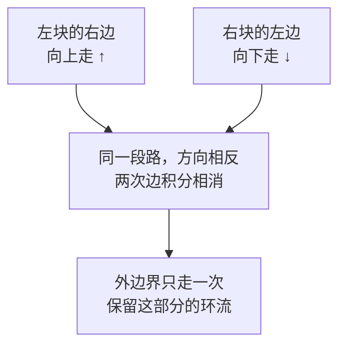

# 平面环流与格林公式

沿着一条封闭的人行道走，风顺路时会帮你，逆路时会阻你。要累计的是风在行进方向上的分量，而不是每点的风速。把场记作 $(P,Q)$，路径参数化为 $(x(t),y(t))$，一小步贡献 $P\,\mathrm dx+Q\,\mathrm dy$；累计就得到第二类曲线积分。对闭合路线，这个量叫环流：

$$
\oint_C P\,\mathrm dx+Q\,\mathrm dy
=\int_a^b [P(x(t),y(t))x'(t)+Q(x(t),y(t))y'(t)]\,\mathrm dt .
$$

同一条路倒走，$\mathrm dx,\mathrm dy$ 同时反号，所以环流反号；第一类曲线积分用的是弧长元 $\mathrm ds$，倒走时不会因此反号。

## 为什么边上的积分能改成里面的积分？

先把一小块矩形按逆时针绕一圈。下边向右、上边向左，所以两条横边合起来是对「下边的 $P$ 减上边的 $P$」做积分，按微积分基本定理就是对 $-P_y$ 积分。右边向上、左边向下，两条竖边合起来则是对 $Q_x$ 积分。这样，一小块的环流来自 $Q_x-P_y$，而不是 $P_x+Q_y$。

把相邻小块合在一起时，公共边为什么不见了？让每一块都把自己的内部留在左手：竖着的公共边是左块的右边，向上走；它同时也是右块的左边，必须向下走。两次线积分恰好相消，余下的才是大区域的边界。

这就是格林公式的环流形式。刚才的矩形推导说明符号从哪里来，公共边消失说明为什么可把局部贡献相加。若 $D$ 是有界平面区域，边界分段光滑、简单闭合（有孔时分别看外、内边界），且 $P,Q$ 在 $D$ 的闭包的一个邻域内连续可微，则

$$
\oint_{\partial D} P\,\mathrm dx+Q\,\mathrm dy
=\iint_D (Q_x-P_y)\,\mathrm dA .
$$

边界的正向始终是「把积分区域留在左手」，因此外圈逆时针，孔的内圈顺时针。若题目指定方向与正向相反，最后整体变号。

## 看见闭路，先检查什么？

求 $(P,Q)=(y^2,3xy)$ 沿矩形 $[0,2]\times[0,3]$ 边界逆时针的环流。四条边逐段积分可行，但题目的「闭合、逆时针」加上 $Q_x-P_y=3y-2y=y$，提示 ==先检查条件，再把环流改成区域积分==：

$$
\int_0^2\int_0^3 y\,\mathrm dy\,\mathrm dx=9 .
$$

用边积分核对：从 $(0,0)$ 开始，下边 $P=0$；右边 $x=2$，贡献 $\int_0^3 6y\,\mathrm dy=27$；上边 $y=3$，向左走给 $\int_2^0 9\,\mathrm dx=-18$；左边 $Q=0$。四段之和也是 $9$。如果图上箭头顺时针，二重积分本身不变，所求环流应为 $-9$。

> [!CAUTION]
> 路径闭合，甚至场在路径上处处光滑，也不够。还要查所围区域内有没有场无定义的点；不能只看边上能不能代入。

例如 $(P,Q)=(-y,x)/(x^2+y^2)$ 在原点无定义；其他点满足 $Q_x-P_y=0$。逆时针半径为 $2$ 的圆上，代 $x=2\cos t$、$y=2\sin t$ 后，$P\,\mathrm dx+Q\,\mathrm dy=\mathrm dt$，所以环流为 $2\pi$，并不为零。若挖掉一个包含原点的小圆盘，格林公式可以用于剩下的圆环；这时左端计算的是外圈和顺时针内圈的总和，而不是只剩原来的外圈。
