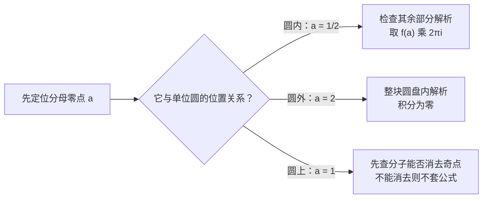

# 柯西积分公式与路径中的奇点

一个闭曲线积分可能是零，也可能正好给出函数在曲线内部某点的值。差别不在曲线有没有闭合，而在于：==把路径向内缩的过程中，哪些点不能跨过去？==

设 $C$ 是逆时针的分段光滑简单闭曲线，$f$ 在 $C$ 及其内部的一个开邻域内解析。对
$$
I(a)=\oint_C\frac{f(z)}{z-a}\,\mathrm dz,
$$
先找 $a$ 与 $C$ 的相对位置，再检查分子还会不会引入别的奇点。下面每个结论都用到了这一解析性条件。

| $a$ 的位置 | 可以怎样变形路径 | 积分 |
| --- | --- | --- |
| 在外部 | 分式在整个内部解析，路径可缩尽 | $0$ |
| 在内部 | 不能跨过 $a$，但能缩到绕它的小圆 | $2\pi i f(a)$ |
| 在路径上 | 先判断是否为可去奇点 | 若 $f(a)\ne0$，通常意义的闭曲线积分不存在；若能解析延拓，延拓后可用柯西积分定理 |

## 为什么留下的是一个点的函数值

若 $a$ 在内部，从区域挖掉以 $a$ 为圆心的小圆。剩下的区域中分式解析。沿一条连接内外边界的割线切开，对切开后的区域用柯西积分定理；割线两侧积分抵消。外边界的逆时针积分便等于小圆的逆时针积分，因为作为挖孔后的内边界，小圆原本按顺时针计入边界和。这和[格林公式里共享边界抵消](平面环流与格林公式.md)是同一个方向记账；此处用的是复函数解析的条件。

把小圆写成 $z=a+r e^{it}$（$0\le t\le 2\pi$）。由于 $\mathrm dz=i r e^{it}\,\mathrm dt$，分母的 $r e^{it}$ 被抵消：
$$
I(a)=i\int_0^{2\pi}f(a+r e^{it})\,\mathrm dt .
$$
左边不随允许的小圆半径改变，右边当 $r\to0$ 时趋于 $2\pi i f(a)$。小圆的长度虽然随半径缩短，核 $1/(z-a)$ 的大小却按反比放大；因此不能仅凭「路径缩小」就把积分判成零。

## 三个点，三种判断

**补充例题**：沿逆时针单位圆取 $f(z)=z^2$。比较 $a=1/2,\ 2,\ 1$ 三个取值。

- $a=1/2$ 时，$f(1/2)=1/4$，结果是 $\pi i/2$。也可先作除法，$\frac{z^2}{z-a}=z+a+\frac{a^2}{z-a}$，前两项是整函数，积分为零。取顺时针方向，答案变为 $-\pi i/2$，但点的内外位置不变。
- $a=2$ 时，整块单位圆盘上没有奇点，结果为零。把 $f(2)$ 硬代进去会得到非零值，正好暴露出漏查位置。
- $a=1$ 时，分子在 $1$ 不为零，所以路径穿过真实极点，不能报一个有限的通常积分值。若把分子换成 $(z-1)^2$，分式可延拓为 $z-1$，此时积分才为零。

> [!WARNING]
> 「沿着路径处处解析」仍然不够。例如 $1/z$ 在单位圆附近解析，但不在整个圆盘内解析。取 $z=e^{it}$ 可直接核得逆时针积分为 $2\pi i$；不能用外圈上的光滑性替代内部无奇点。
