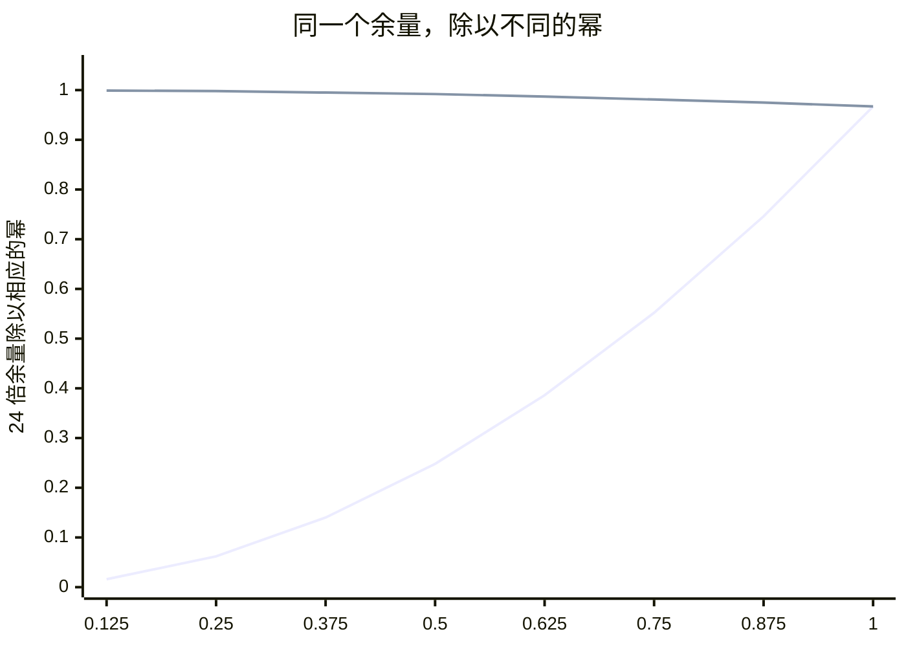

# 泰勒公式与余项

切线能交代函数在一点的取值和斜率，但两个函数即使共用一条切线，也可能一个向上弯、一个向下弯。若一次项刚好为零，该看什么？可以继续匹配二阶、三阶导数，让多项式不只贴住切线，还保留更细的局部变化。

例如，把展开点写成 $a$，令 $h=x-a$。在多项式 $c_0+c_1h+c_2h^2+\cdots$ 中，到 $h=0$ 求二阶导只剩 $2!c_2$，求 $k$ 阶导只剩 $k!c_k$。要让这些导数与 $f$ 逐阶吻合，系数便不能任意选择：

$$
P_n(a+h)=\sum_{k=0}^{n}\frac{f^{(k)}(a)}{k!}h^k.
$$

## 要的是误差的阶，还是误差的数值？

如果 $f$ 在 $a$ 的邻域内有直到 $n$ 阶的连续导数，泰勒公式可写成 $f(a+h)=P_n(a+h)+o(h^n)$（$h\to 0$）。这里的余项表示误差除以 $h^n$ 后趋于零。它适合回答「除以 $h^n$ 之后还剩什么」，却不直接告诉你 $h=0.1$ 时误差到底有多大。

若 $f$ 在连接 $a$ 和 $a+h$ 的区间上有 $n+1$ 阶连续导数，则对 $h\ne 0$，存在两点之间的 $\xi$，使
$$
f(a+h)-P_n(a+h)=\frac{f^{(n+1)}(\xi)}{(n+1)!}h^{n+1}.
$$
这是拉格朗日余项。一旦能在这一段上把 $|f^{(n+1)}|$ 压在 $M$ 以下，就有可用于估算的上界 $M|h|^{n+1}/(n+1)!$。换远一点的输入，原来的上界未必仍然适用，因为要重新检查整个区间，而不只检查展开点。

## 分子相消时，展开到哪里？

求
$$
\lim_{x\to0}\frac{\cos x-1+x^2/2}{x^4}.
$$
分子已写出与 $\cos x$ 相消的常数和二次项；分母是四次，所以 ==展开要保留到四次==：算到二次虽然够看出相消，却不够决定结果。$\cos x$ 的奇数阶导数在零点为零，四阶导数在零点为 $1$，从而
$$
\cos x=1-\frac{x^2}{2}+\frac{x^4}{24}+o(x^4),\qquad
\lim_{x\to0}\frac{\cos x-1+x^2/2}{x^4}=\frac{1}{24}.
$$
图中把分子同乘 $24$，分别除以 $x^2$ 和 $x^4$。横轴是等距取样；从左端看，两条线分别接近 $0$ 与 $1$。是分母的阶决定了能不能看见相消后留下的那一项。

> [!WARNING]
> 不能先把 $\cos x$ 换成 $1-x^2/2$，再说分子等于零。把问题缩成最简单的版本：$x^2$ 和 $x^2+x^4$ 有相同的二阶泰勒多项式，但两式的差除以 $x^4$ 恰好是 $1$，并不随 $x$ 变小。

再问一个不同的问题：用 $1-x^2/2$ 估算 $\cos(0.1)$ 能有多准？三次泰勒多项式恰好等于二次泰勒多项式，因为三次项的系数为零。取三阶公式的拉格朗日余项，且四阶导数 $\cos\xi$ 的绝对值不超过 $1$，得到
$$
|\cos(0.1)-0.995|\le \frac{0.1^4}{24}<4.17\times 10^{-6}.
$$
同一个多项式，用来求极限时我们追踪相消后的第一项；用来报近似精度时则要把余项控制在给定输入所在的区间内。
